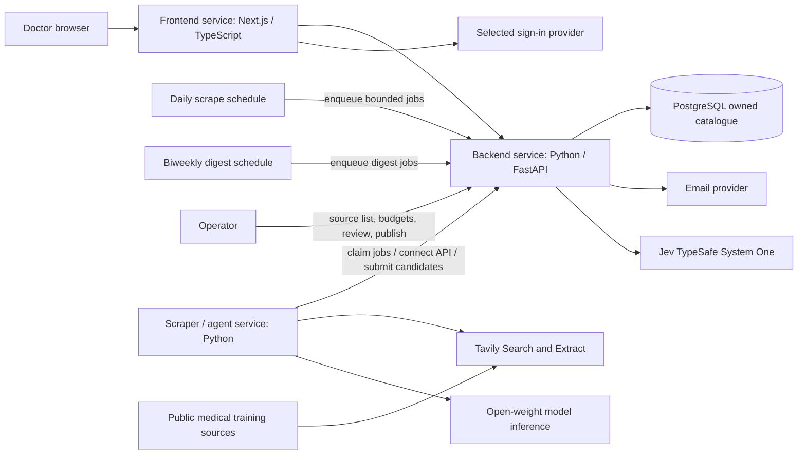

# CareCredits — spec-driven development specification

Version: 0.8 · 2026-09-24 · Status: implementation specification; portal and three-service split exist on this branch; DEC-09–11 and BUILD-10 (digests/suggestions/certificates) are implemented on the working path. Live TypeSafe Jev and open-weight model DEMO-01 still need owner API keys.

This document expands the initial Tavily discovery specification using the owner's supplied meeting summary. It defines the full Malaysia MVP and the contracts needed to build it. It does not claim that the described application is already implemented.

## 1. Source of requirements and precedence

The meeting decisions are the product baseline. Earlier instructions additionally require actual Tavily API usage and mention a Nebius backend. The earlier design placed scraping inside FastAPI; **the meeting decision supersedes that target architecture: the scraper must become a separate Python service**. Existing adapter code should be reused during the move.

Spelling is normalized to **Tavily** from “Tavalli.” “DiveScript” is interpreted as JavaScript as stated in the summary. Retaining the existing TypeScript/Next.js frontend meets the JavaScript-based service decision; a rewrite to plain JavaScript is not required.

| ID | Confirmed owner/meeting requirement |
| --- | --- |
| DEC-01 | Three separately runnable application services: backend, frontend, scraper |
| DEC-02 | Python backend owns the primary PostgreSQL database |
| DEC-03 | Python scraper and JavaScript-based frontend |
| DEC-04 | Tavily API collects training data; real Search and Extract usage is required |
| DEC-05 | Initial geography is Malaysia; user-facing terminology is CPD |
| DEC-06 | Doctor sign-in, nearby discovery, sign-up tracking, attendance tracking and learning progress |
| DEC-07 | Show CPD points, prerequisites, beginner/intermediate/advanced difficulty, and fees |
| DEC-08 | Use open-weight models for application AI |
| DEC-09 | Own the Malaysia CPD catalogue: agents scrape public medical training sources on a daily schedule into CareCredits' database; doctors search that catalogue only. Paid Tavily/model calls are operator/agent budget, never per-user search. The product aim is to become the trusted default source of CPD training data |
| DEC-10 | Keep doctors engaged with their learning: track recorded credits, surface upcoming courses they should consider, email a digest every two weeks with upcoming events and prices plus current credit totals, and offer a printable CareCredits certificate doctors can send to organisations showing CareCredits affiliation and that their tracked credits are up to date on the platform |
| DEC-11 | Catalogue writes go through CareCredits **API connect endpoints** into the owned PostgreSQL database (no scraper direct DB writes). Before saving, call **Jev** (TypeSafe System One) against retrieved catalogue matches to decide whether an event already exists, is new, or is uncertain; **save new events** only when the judgment is `new` (or after operator review when uncertain). Exact URL/`source_key` matches remain deterministic short-circuits |

An implementation default below is a concrete proposal, not a recorded meeting decision. Defaults can be revised with a documented reason; they must not silently change confirmed requirements. Official hackathon rules, model eligibility, deadline and judging criteria are still unverified. Nebius remains an open dependency decision, not a cancelled requirement.

## 2. Product goal and success

Help doctors in Malaysia find relevant CPD training, maintain a personal record of activities they have signed up for and attended, stay informed about upcoming opportunities and their credit totals, and share a printable CareCredits affiliation certificate with organisations when asked.

The problem hypothesis is that opportunities and records are fragmented, and doctors lose track of what to take next; user research has not yet established its frequency or cost.

**Hackathon / core portal success:** a doctor can sign in, choose a Malaysian location, find a real source-backed training **from CareCredits' own catalogue**, inspect its points and practical requirements, open the provider's registration page, record a sign-up, mark attendance, and see the personal dashboard update without duplicating the activity or its points. Doctor search must not trigger a live Tavily call.

**Engagement success (DEC-10):** the doctor can see credit progress and suggested upcoming catalogue courses; receive an opted-in email every two weeks summarising upcoming events with prices and current recorded CPD totals; and download/print a CareCredits certificate stating platform affiliation and that their tracked credits are current on CareCredits. The certificate is **not** a regulator licence, MMC attestation, or independent verification of attendance.

Strategic product intent (DEC-09): CareCredits becomes the gold-standard Malaysia CPD dataset by continuously collecting and reviewing public medical training sources into PostgreSQL. Users come for the catalogue quality and freshness; operators control spend by budgeting daily scrape jobs instead of paying on every doctor keystroke.

**Catalogue write path (DEC-11):** the scraper/agent connects to the owned database only through backend API connect endpoints. After extraction, the backend loads likely existing sessions, asks **Jev** whether the candidate already exists, and saves new events into PostgreSQL when Jev returns `new`. Uncertain matches stay in the operator review queue instead of silently merging or duplicating.

The hackathon demonstration must additionally show a real Tavily Search → Extract run and a real open-weight model extraction run. Saved fixtures may support offline development but cannot substitute for those claims. Biweekly email and printable certificates may be demonstrated with fixtures or a single manual send if the mail provider is not yet live.

### MVP boundary

**Core portal (ship first):** sign-in, profile/location, database-backed discovery and filters, training detail, personal sign-up and attendance records, CPD progress, operator ingestion/review, source evidence, and loading/empty/error states.

**Engagement layer (DEC-10 — planned product scope after core portal works):** optional biweekly digest emails, catalogue-based “consider next” course suggestions from the owned database (rule-based on city/mode/upcoming date — not a closed-weight recommendation engine), and printable affiliation certificates.

Implementation defaults:

- Sign-up means **recording that the doctor registered externally**. The app links to the provider; clicking the link alone does not register the doctor. Integrated booking/payment is outside MVP.
- Attendance is a reversible self-reported record. It is not independently verified completion or regulator-approved credit.
- Progress means signed-up count, attended count, and separately labelled recorded CPD totals. Optional personal notes support reflection; quizzes, competency scoring and an LMS are outside MVP.
- Online training is included only when a source establishes Malaysian relevance or participation eligibility. Global online training is not included merely because it is reachable from Malaysia.
- No automatic licence-renewal decision, universal legal annual target, accreditation guarantee, payment collection, or **certificate OCR of third-party documents**. CareCredits **may** issue its own printable affiliation certificate (DEC-10).
- Email digests are **opt-in**, every **14 days**, and use catalogue + personal progress data only — never a live Tavily call per recipient.
- “Courses you need to take” means **suggested upcoming catalogue sessions** filtered by the doctor's profile (e.g. city, mode) and recent activity gaps — not a claim that the doctor is non-compliant with any board.

## 3. Domain vocabulary

| Term | Definition |
| --- | --- |
| Training | A learning activity described by a provider |
| Session | One dated occurrence of a training; personal records attach to this occurrence |
| CPD points | User-facing label for advertised learning credits; it does not establish eligibility |
| Source credit label | Original provider wording, such as CPD, CME or CE, preserved alongside the UI label |
| Source | Original page URL and the retrieved evidence supporting an event field |
| Signed up | Doctor's record that external registration occurred |
| Attended | Doctor's self-reported participation in a session |
| Recorded points | Points the doctor explicitly records for attendance; distinct from advertised points |
| Verified | A specific claim reviewed against identified evidence, with reviewer and date |
| Unknown | Source does not establish a value; stored as null, never zero or a guessed value |
| Suggested training | Upcoming catalogue session offered to a doctor based on profile filters and gaps — advisory only |
| Biweekly digest | Opt-in email every 14 days with upcoming events, listed prices, and the doctor's current recorded CPD totals |
| Affiliation certificate | Printable CareCredits statement that the named doctor is affiliated with the platform and that their tracked credits were current as of the issue date; not a regulator document |

Calling credits CPDs in the UI does not imply that global schemes are equivalent or convertible. A source credit label that is not approved for aggregation remains visible but excluded from the CPD subtotal with an explanation.

## 4. Users and journeys

### Doctor

1. Sign in and create a profile; no claim of medical registration verification is made.
2. Select city/state or optionally consent to location access. Location denial does not block use.
3. Search upcoming trainings, filter by date, delivery mode, distance/location, cost, difficulty and advertised CPD points.
4. Open training details: provider, time, venue/online mode, prerequisites, difficulty, fees, advertised points, registration link and supporting sources. Unknowns are explicit.
5. Open the external registration link. Return and choose “Mark as signed up”; the portal records the user's assertion.
6. After the event, choose “Mark as attended,” optionally record points and notes, then inspect updated progress. Correcting attendance or points recomputes totals.
7. Opt in to biweekly digests; receive email updates on upcoming catalogue events (with prices where known) and current recorded CPD totals.
8. Review suggested upcoming courses from the owned catalogue when the portal highlights sessions to consider next.
9. Download/print a CareCredits affiliation certificate to share with organisations; the document states platform affiliation and tracked-credit currency, not board compliance.

### Operator

1. Configure server secrets locally or in deployment secret settings.
2. Maintain the curated set of Malaysia medical training sources / topics that the daily agent scrapes.
3. Inspect scheduled and manual ingestion jobs, status, usage and source coverage.
4. Review extracted candidates, ambiguous dates, missing fields, conflicts, duplicates and Malaysia eligibility.
5. Publish a source-supported session or reject/hold it with a reason. Publication is not accreditation verification.
6. Refresh a source; review material changes before updating published records. Daily scrapes propose updates; operators still gate publication.

## 5. Target architecture

| Component | Owns | Must not own |
| --- | --- | --- |
| Frontend | Sign-in experience, catalogue discovery, details, personal portal, digest preferences, certificate download, accessible UI | Tavily/model keys, operator token, direct database access, live scrape triggers, raw mail credentials, TypeSafe/Jev keys |
| Backend | Authentication enforcement, authorization, **owned CPD catalogue**, **API connect endpoints** to PostgreSQL, personal records, job state, scrape and digest schedules, validation, publication, persistence, progress, digest composition, certificate issuance, **Jev existence judgments** before save | Direct Tavily/model calls in the target architecture |
| Scraper / agent | Daily and manual job execution, Tavily adapter, extraction, open-weight model invocation, candidate construction; talks to catalogue only via backend connect/job APIs | Doctor records, **direct PostgreSQL credentials**, final publication decisions, doctor-facing search, email to doctors, TypeSafe/Jev keys (unless explicitly delegated) |
| PostgreSQL | Durable catalogue, personal, digest, certificate and ingestion records — the system of record users search | Public browser access |
| Email provider | Delivery of opted-in digests | Catalogue truth or publication decisions |
| Jev (TypeSafe) | Typed existence / duplicate / uncertain judgments over candidate vs catalogue match state | Generating event text, publishing, or bypassing evidence validation |

PostgreSQL is infrastructure, not a fourth application service. External identity, Tavily, open-weight inference, email, and TypeSafe/Jev are dependencies. Each application service needs its own entry point, container build and health check. **Only the backend has PostgreSQL write credentials.** The scraper connects through authenticated backend API endpoints (claim/complete plus catalogue connect/lookup/save). Completion and save are idempotent. A crashed worker cannot cause silent loss or double publication.

### Migration from the current branch

The existing `backend/discovery.py` implements synchronous operator discovery inside FastAPI. Move its Tavily adapter and tests into the scraper service without losing provenance, bounds or error behavior. Add job contracts and backend-owned candidate storage. The existing `/discovery/search` is transitional and must be removed or explicitly disabled in the public release after migration; do not silently change its synchronous response into a job response. Update the setup command and Compose secret routing when the service moves.

The existing backend user-list/create endpoints are unauthenticated, and `backend/auth.py` says authentication is disabled. Restrict or replace them as part of sign-in work before a doctor pilot. A discovery bearer token does not solve user authentication.

## 6. Tavily and open-weight model pipeline

**Owned catalogue rule (DEC-09):** doctors and the public profile always read PostgreSQL. Tavily and the model run only inside scraper jobs started by operators or by the daily schedule. This is how CareCredits controls API credits and builds a durable gold-standard dataset instead of a pass-through search box.

**API connect + Jev existence (DEC-11):** the scraper never opens a database connection. It uses authenticated backend connect endpoints to look up catalogue rows and to save new events. Before insert, the backend asks Jev whether the candidate already exists in the retrieved match set.

1. A daily schedule (and optional operator run) enqueues bounded Malaysia-specific ingestion jobs for curated topics or known medical training sources.
2. Scraper claims the job and calls Tavily Search with bounded results against those sources / topics.
3. Canonicalize URLs conservatively, remove fragments, reject invalid/non-web/local URLs, and deduplicate exact source URLs. Do not strip meaningful query parameters.
4. Call Tavily Extract for the selected pages. Preserve snippets when extraction fails, with explicit failure status; snippet-only candidates remain in review and are not auto-published.
5. Send successful page text to the configured **open-weight model** to extract schema-conforming candidate sessions. Extract multiple sessions separately when a page describes several events.
6. Validate dates, values, enum fields and source excerpts deterministically. Model confidence does not prove correctness. Unsupported or malformed fields become null/review findings; do not repair them by inventing facts.
7. Scraper/backend **connect** to the owned catalogue via API: lookup by exact `source_key` / canonical URL first. If exact match → treat as **exists** (propose field updates for review; do not create a duplicate). If no exact match, retrieve a small set of near-neighbours (same provider/city/date window or fuzzy title) from PostgreSQL.
8. Call **Jev** (`POST https://api.typesafe.ai/v1/systemone`, model `jev-latest`) with dense state `{candidate, matches[]}` and a `choice` question whose criteria are `exists` / `new` / `uncertain`. Act on the typed answer and confidence threshold (default: require confidence ≥ 0.7 to auto-apply `exists` or `new`; otherwise force `uncertain`).
9. **Save new events** through the connect/save API only when the judgment is `new` and evidence validation passes — persist as a candidate awaiting publish, or as a published session when the operator policy allows auto-publish of high-confidence new rows (default: still operator-publish). `exists` links to the matched session and queues a refresh diff. `uncertain` lands in the operator review queue with the Jev probabilities attached.
10. Doctor searches use PostgreSQL only — never a paid Tavily or Jev request on search, filter, or page load.
11. Re-scrapes of the same source propose updates; material field changes require operator review before overwriting a published session.

The scraper uses Tavily for search/extraction and the open-weight model for structured interpretation. **Jev is used for catalogue identity judgments only** (exists vs new vs uncertain), not for generating event fields. Disable optional generated Tavily search answers in the application flow. Do not claim that Tavily's or TypeSafe's internals are open-weight: DEC-08 still governs application extraction AI; DEC-11 adds Jev as an explicit typed-decision dependency for deduplication.

**Default job design:** PostgreSQL-backed jobs owned by the backend; the scraper polls a claim endpoint. Claims are atomic, one worker owns a job lease, and completion/save are idempotent.

### Model selection contract

Before choosing a model, record its identifier/version, publisher, weights source, licence, hosting provider, structured-output support, context limit and evidence that the weights are available. Open-weight is not automatically the same as unrestricted open-source licensing.

The model must accept source text and return structured event candidates, handle relevant English/Malay text, preserve source-language evidence, and support the selected deployment budget. Run an evaluation against reviewed examples before adopting it. No closed-weight fallback is allowed silently. Model failure leaves evidence in review or marks the job partial/failed; a demo fixture must be labelled.

Earlier Nebius intent is preserved: confirm whether Nebius is required for inference, application hosting, or both before locking deployment. Keep `MODEL_BASE_URL`, `MODEL_ID`, and `MODEL_API_KEY` configurable as a proposed interface; these variables and a model adapter are not implemented yet.

## 7. Functional requirements

Statuses describe this branch: **existing** means implemented code, not live-provider verification; **planned** means required work.

| ID | Requirement | Acceptance criterion | Status |
| --- | --- | --- | --- |
| AUTH-01 | Doctor sign-in/out | Selected provider session is validated server-side; logout invalidates local session; unauthenticated personal requests return 401 | Existing email/password sessions on this branch; third-party OAuth remains OPEN-04 |
| AUTH-02 | Ownership isolation | A doctor cannot read or change another doctor's profile, registrations, attendance, notes or totals by changing IDs | Existing; covered by portal isolation tests |
| GEO-01 | Malaysia location | City/state entry works without GPS; exact coordinates are optional; non-Malaysian in-person events cannot publish | Existing city/state profile and catalogue filters; extraction rejects non-MY country |
| GEO-02 | Nearby search | Use distance only when user and venue coordinates exist; otherwise use city/state and show distance unavailable | Existing; distance is approximate and omitted when venue coordinates are missing |
| DISC-01 | Real Tavily Search | Bounded request uses Search for Malaysian medical training sources | Existing in scraper; live call unverified |
| DISC-02 | Real Tavily Extract | Extract at most five unique returned URLs; empty Search results skip Extract | Existing in scraper; live call unverified |
| DISC-03 | Provenance | Preserve URL, retrieval time, source text and extraction outcome through candidate/publication flow | Existing on candidates; source text is operator-only |
| DISC-04 | Failure honesty | Partial extraction keeps evidence and warnings; provider failure is never fabricated success | Existing job statuses and warnings |
| DISC-05 | Bounded work | Query 3–300 trimmed characters; 1–5 search results; 30 seconds per Tavily call; no automatic paid retries | Existing; retain |
| AI-01 | Open-weight extraction | Approved open-weight model produces validated candidates with field-level excerpts and model/version metadata | Adapter existing; model choice and live run remain OPEN-03 / DEMO-01 |
| EVT-01 | Required training fields | Details show title, provider, session dates, delivery mode/location, CPD points, prerequisites, difficulty and fees; unknowns are explicit | Existing in catalogue and detail UI |
| EVT-02 | Event identity and updates | Same source/session does not duplicate; different sessions on one page remain distinct; ambiguous matches require review | Partial: source_key deduplicates; no separate Training/Session tables |
| EVT-03 | Claim verification | Advertised points, publication and accreditation verification remain separate; verified claims have evidence/reviewer/time | Partial: publication requires source excerpts and stays `unverified` |
| FIND-01 | Catalogue filters | Combine text, date, city/state or radius, mode, points, difficulty and fee filters with pagination; clearing filters resets results | Existing SQL filters on indexed columns; unknown dates/fees/points need `include_unknown` |
| REG-01 | Sign-up record | Explicit user action records external sign-up once per doctor/session; opening provider link does not create a record | Existing boolean sign-up; cancelled status not modelled |
| ATT-01 | Attendance record | User can mark eligible past/started session attended and correct it; future sessions cannot be marked attended | Existing; optimistic versioning on save |
| PROG-01 | Personal progress | Selected-year counts and recorded points derive from attendance; corrections cannot double count; unknown/unapproved values are excluded and disclosed | Existing year dashboard with excluded-count disclosure |
| PROG-02 | Suggested next courses | Portal shows upcoming owned-catalogue sessions filtered by doctor profile (city/mode) and recent gaps; copy is advisory (“consider”), never a compliance verdict | Implemented |
| NTF-01 | Biweekly digest email | Opted-in doctors receive an email every 14 days with upcoming events, known prices, and current recorded CPD totals; unsubscribe works; no Tavily call per send | Implemented (MAIL_PROVIDER=log default; SMTP optional) |
| CERT-01 | Printable affiliation certificate | Doctor can download/print a CareCredits PDF/statement naming them, issue date, recorded CPD total for the selected year, and clear non-regulator disclaimer; suitable to share with organisations | Implemented (printable HTML) |
| UI-01 | Full portal | Sign-in, discovery, detail, signed-up/attended lists and progress have loading, empty, error and retry states | Existing Next.js portal, including labelled demo fixtures |
| SEC-01 | Private secret setup | Hidden input saves ignored owner-readable `.env`; no key reaches frontend or logs | Existing `scripts/setup_integrations.py`; Tavily/model keys stay on scraper |
| SEC-02 | Operator/service access | Doctor cannot start jobs or publish; scraper token cannot access personal data; missing integration configuration fails explicitly | Existing operator role and scraper bearer token |
| OPS-01 | Controlled ingestion | Durable leased jobs, bounded workers, pagination, usage metadata and an explicit run budget; doctor search never calls Tavily | Existing claim/heartbeat/complete plus explicit interrupted-job retry |
| OPS-02 | Daily owned-catalogue scrape | A schedule enqueues bounded jobs for the curated Malaysia medical source/topic list once per day (timezone Asia/Kuala_Lumpur); usage is attributed to the operator budget; failures stay honest and never auto-replay paid calls | Existing: `backend/schedule.py`, lifespan tick, `POST /api/v1/admin/daily-scrape`, `config/scrape_topics.json` |
| CAT-01 | API connect to owned DB | Scraper/agent authenticates to backend connect endpoints; only the backend opens PostgreSQL; connect readiness fails closed if the DB is unreachable | Existing: `/internal/v1/catalogue/connect|lookup|decide|save` |
| JEV-01 | Jev existence judgment | For each validated candidate without an exact `source_key` match, backend queries Jev with candidate + match set; outcomes are `exists`, `new`, or `uncertain` with stored probabilities; doctor search never calls Jev | Existing adapter; live TypeSafe call needs `TYPESAFE_API_KEY` (OPEN-11). Without the key, near matches stay `uncertain` |
| CAT-02 | Save new events | When judgment is `new` (or operator publishes an uncertain/new candidate), persist the event into the owned catalogue with evidence; never duplicate an exact `source_key` | Existing: `decision=new` publishes a searchable course; uncertain stays held; heuristic extract is used when no open-weight model is configured |
| DEMO-01 | Real demonstration | Show one live Search/Extract run, one eligible model run, published results and personal tracking flow; separate live from fixture evidence | Pending |

## 8. Behavioural rules and defaults

### Discovery and location

- Default geography: country `MY`. A Malaysian webpage address alone is not proof of event location.
- Default time filter: upcoming sessions, ordered by next session start then stable ID. Unknown dates appear only when the user includes “Date not confirmed.”
- Nearby default: 25 km, selectable 10/25/50/100 km. These are product defaults, not meeting decisions. Calculate straight-line distance in the backend and label it approximate, not travel time.
- Without coordinates, use city/state matching. Online sessions have no distance; show them only when online/hybrid inclusion is selected and Malaysian relevance is established.
- Store timestamps in UTC when timezone is known and display Malaysian sessions in `Asia/Kuala_Lumpur`. Preserve date-only values as dates; do not invent a midnight time. Source timezone ambiguity stays in review.
- Difficulty is `beginner`, `intermediate`, `advanced`, or null. Do not infer it from points or price. Model suggestions without explicit source support remain review suggestions.
- Fees use decimal amounts and a currency code. Free means explicitly zero; unknown is null. MYR fee filters exclude other currencies and unknown values unless requested; no implicit currency conversion.
- Prerequisites may be source-supported text, explicitly “none stated by provider,” or unknown. Absence of text is not proof of no prerequisites.

### Personal tracking

Use separate fields `signup_status` (`not_recorded`, `signed_up`, `cancelled`) and `attendance_status` (`not_recorded`, `attended`). Attendance may be recorded without a prior sign-up because the doctor may discover an event retrospectively. Cancelling a sign-up does not erase past attendance.

A doctor can mark attendance when the session start has passed; date-only sessions become eligible on that local date. Unknown dates require the user to provide a non-future `attended_on` date. Corrections must preserve a change history. Marking attendance alone does not silently turn advertised points into earned points.

`recorded_points` is optional, nonnegative decimal, with `points_origin` (`self_reported`) and a preserved credit label. The selected-year dashboard sums only attended records with explicit eligible-to-aggregate CPD labels and known recorded points. Show excluded unknown/unmapped records separately. Removing attendance excludes its points while preserving correction history. No preset legal annual target or automatic CE/CME conversion is allowed. Which labels can aggregate is an operator-reviewed configuration, initially CPD only.

## 9. Data model

Use migrations and stable IDs. Existing integer user IDs may remain during migration; external identity references must be unique. All user-owned foreign keys derive from the validated session, not caller-supplied owner IDs.

| Entity | Core fields and constraints |
| --- | --- |
| DoctorProfile | user_id; identity_issuer + identity_subject unique; display_name; city/state; optional coordinates; location_consent_at; created_at |
| Training | id; title; provider_name; description; prerequisites nullable; difficulty nullable; created_at/updated_at |
| Session | id; training_id; start/end timestamps or date-only fields; timezone; mode; country/city/state/venue; nullable coordinates; fee_amount/currency; advertised_points; original_credit_label; registration_url; publication_status; cancellation_status |
| SourceDocument | id; canonical_url; content_hash; retrieved_at; extraction_status; source excerpt/text; ingestion_job_id; unique URL+content hash |
| FieldEvidence | session/candidate reference; field_name; source_document_id; verbatim excerpt; reviewed_by/at nullable |
| Candidate | id; ingestion_job_id; source-local event key; structured payload; schema_version; model metadata; validation findings; review state/reason; resulting session_id nullable |
| DoctorSession | id; user_id+session_id unique; signup_status; attendance_status; signed_up_at; attended_on; nullable recorded_points; original_credit_label; points_origin; optional personal_notes; version |
| DigestPreference | user_id unique; opted_in; cadence_days default 14; last_sent_at; unsubscribed_at |
| DigestSend | id; user_id; sent_at; status; event_count; recorded_points_snapshot; provider_message_id nullable |
| AffiliationCertificate | id; user_id; year; recorded_points_snapshot; issued_at; document_hash; disclaimer_version |
| IngestionJob | id; request key; query; limits; status; attempt; lease token/expiry; timestamps; provider outcomes; measured usage if available; sanitized error |
| AuditEvent | actor; entity/action; timestamp; changed fields; no secrets; doctor history visible only to its owner/admin policy |

Database checks enforce nonnegative fees/points, valid enums, end not before start, exactly defined date precision, and duplicate personal-record prevention. Date-only and timestamp representations must not disagree.

Same URL can describe many sessions. Deduplicate source documents independently of event identity. Candidate matching considers provider, title, session date and location; uncertain matches are reviewed, not automatically merged. Refreshes create new evidence versions and do not overwrite a doctor's attendance/points. Published sessions are retained or cancelled rather than deleted out from under personal records.

## 10. Target API and service contracts

All routes in this section are **planned** except the transitional route in section 11. JSON uses snake_case. Doctor authentication follows the selected identity provider; operator and scraper permissions are distinct. Mutation requests use server-side authorization and validation, including CSRF protection if cookie sessions are used.

| Method and route | Caller | Contract |
| --- | --- | --- |
| GET/PATCH `/api/v1/me` | Doctor | Read/update own location/preferences; no caller-supplied owner ID |
| GET `/api/v1/trainings` | Doctor | Query/filter catalogue; `page` >=1, `page_size` 1–50 (default 20); return items, total, page and applied filters |
| GET `/api/v1/trainings/{session_id}` | Doctor | Session detail, source evidence, publication/review labels and registration URL |
| GET `/api/v1/me/trainings` | Doctor | Filter own signed-up/attended records, paginated |
| PUT `/api/v1/me/trainings/{session_id}` | Doctor | Upsert signup/attendance, points and notes; version check prevents lost edits |
| GET `/api/v1/me/progress?year=YYYY` | Doctor | Counts, recorded CPD subtotal, excluded-record count/reasons; no compliance verdict |
| GET `/api/v1/me/suggestions` | Doctor | Upcoming catalogue sessions to consider (city/mode filters); advisory copy only |
| GET/PATCH `/api/v1/me/digest` | Doctor | Read/update opt-in for the 14-day digest; unsubscribe sets opted_in false |
| POST `/api/v1/me/certificates` | Doctor | Issue a printable affiliation certificate for a selected year; returns download URL or PDF bytes |
| GET `/api/v1/me/certificates/{id}` | Doctor | Download own previously issued certificate |
| POST `/api/v1/admin/ingestion-jobs` | Operator | `{query,max_results}`; require Idempotency-Key; return 202 + job_id/status |
| GET `/api/v1/admin/ingestion-jobs/{id}` | Operator | State, counts, warnings and usage; no credentials |
| POST `/api/v1/admin/ingestion-jobs/{id}/retry` | Operator | Re-queue an `interrupted` job only; 409 otherwise; never auto-replays paid calls |
| GET `/api/v1/admin/candidates` | Operator | Paginated review queue |
| POST `/api/v1/admin/candidates/{id}/review` | Operator | publish/reject/hold, reason, version and evidence-backed corrections |
| POST `/internal/v1/jobs/claim` | Scraper | Atomically lease one queued job; 204 if none; return lease_token and bounded job payload |
| POST `/internal/v1/jobs/{id}/heartbeat` | Scraper | Matching lease token extends lease within job deadline |
| POST `/internal/v1/jobs/{id}/complete` | Scraper | Matching lease + candidate batch + outcomes; idempotent completion |
| GET `/internal/v1/catalogue/connect` | Scraper | Readiness: confirms backend↔PostgreSQL connect for catalogue writes; 503 if DB unavailable; no secrets in body |
| POST `/internal/v1/catalogue/lookup` | Scraper / Backend | `{candidate}` → exact `source_key` hit and/or near-neighbour sessions for Jev state; never returns other doctors' personal data |
| POST `/internal/v1/catalogue/decide` | Backend (or scraper via backend) | Runs Jev existence choice over `{candidate, matches}`; returns `{decision, confidence, probabilities, matched_session_id?}`; stores judgment on the candidate |
| POST `/internal/v1/catalogue/save` | Scraper / Backend | Saves a **new** event when decision is `new` (or operator-approved); 409 on exact duplicate; queues update diff when `exists` |
| GET `/health/live` and `/health/ready` | Infrastructure | Liveness independent of paid providers; readiness reports required local configuration/connectivity including DB connect |

Catalogue query fields: `q`, `city`, `state`, `latitude`, `longitude`, `radius_km`, `date_from`, `date_to`, `mode`, `difficulty`, `min_points`, `max_fee_myr`, `include_unknown`, `page`, `page_size`. Coordinates must be supplied together; radius requires coordinates. Incompatible/invalid filters return 422. Filtering by points or fees excludes unknowns unless explicitly included.

Normal responses are 200/201; jobs use 202. Return 401 for missing authentication, 403 for wrong role, 404 for unavailable or other-user records, 409 for version/idempotency conflict, 422 for invalid values and 429 for application throttling. Use a stable `{error:{code,message,request_id}}` envelope for target endpoints; never leak provider bodies or internal stack traces.

DoctorSession PUT represents the desired full state and includes the last-read `version` (0 for creation). Repeating an already-applied identical request returns the current record; a stale request that would change current state returns 409. DB uniqueness protects concurrent first writes. Missing source points do not prevent recording attendance.

### Job durability and limits

States: `queued → running → succeeded | partial | failed`; expired leases become `interrupted`, requiring an explicit operator retry with a new attempt. Do not automatically repeat paid calls after an ambiguous crash. Reusing the same idempotency key and body returns the same job; a different body returns 409. Completion checks lease ownership and stores candidates and terminal status in one transaction.

Defaults: one active worker, five source pages per job, maximum ten manually started jobs per operator per hour, 120-second lease with heartbeat every 30 seconds, five-minute total deadline. Apply per-call timeouts within that deadline. Model input/output caps are set after model selection; missing caps block model job readiness. These bounds limit work, not a guaranteed monetary spend. Record reported usage when available; unknown usage is null.

**Daily schedule (DEC-09 / OPS-02):** enqueue one bounded job per curated topic or source family per day in `Asia/Kuala_Lumpur`, with an operator-configurable daily credit/job ceiling. The schedule creates the same job records as manual runs; it does not bypass leases, idempotency, or review. Missed days do not catch up by blasting unpaid backlog — operators choose whether to backfill. No doctor-facing “live scrape this query now” control in MVP.

**Biweekly digest schedule (DEC-10 / NTF-01):** every 14 days in `Asia/Kuala_Lumpur`, the backend selects opted-in doctors whose `last_sent_at` is due, composes a digest from the owned catalogue (upcoming sessions with known/unknown prices labelled) plus that doctor's progress snapshot, and sends through the configured email provider. Failures are logged and retried with a bounded backoff; never call Tavily to personalize a digest. Unsubscribe links must work without signing in.

## 11. Existing implementation and evidence

This branch implements the three-service target: FastAPI owns PostgreSQL (or SQLite demo), the scraper owns Tavily plus model extraction, and the Next.js portal talks only to `/api/v1`. The transitional `POST /discovery/search` adapter was moved to `scraper/tavily.py` and the synchronous operator endpoint was removed rather than given a job-shaped response.

Doctor journeys use httponly session cookies, CSRF origin/`X-Care-Client` checks, catalogue filters, personal sign-up/attendance records, year progress, catalogue suggestions, opt-in biweekly digests, printable affiliation certificates, and an optional public profile. Operators create idempotent ingestion jobs; the scraper claims a 120-second lease, calls Tavily Search/Extract, and stores source URLs on the job even when model extraction is not configured. Candidates still require source excerpts before publish. Interrupted jobs stay interrupted until `POST /api/v1/admin/ingestion-jobs/{id}/retry`. Daily scrape enqueue (OPS-02) and catalogue connect/lookup/decide/save with Jev (DEC-11) are wired; live TypeSafe and open-weight model DEMO-01 still require owner API keys.

Mocked tests cover Tavily bounds, extraction validation, two-user isolation, filter semantics, nearby city fallback, unknown-value inclusion, explicit job retry, digest opt-in/unsubscribe/send, suggestions, and certificates. They do not spend API credits. No live open-weight model run has been recorded (DEMO-01). Identity is local email/password until OPEN-04 is resolved. Candidate `hold` now requires a review reason and stays out of the catalogue until publish. Target `{error:{code,message,request_id}}` envelopes and cancelled `signup_status` are still unimplemented. Demo fixtures load only when `DEMO_MODE=true` outside production and are labelled fictional.

## 12. Security, privacy and operational requirements

- Prefer the existing repository's intended third-party OAuth direction; select a provider before implementing sign-in. Validate token issuer/audience/session expiry. Never accept an arbitrary email or user ID as identity proof.
- Separate doctor, operator and scraper permissions. Scraper cannot read personal profiles, notes or attendance. Frontend cannot obtain service tokens.
- After the service split, give Tavily/model secrets only to scraper; give database credentials only to backend. Restrict browser origins and internal endpoints. Current broad CORS and unauthenticated user endpoints must be corrected before a pilot.
- Collect city/state by default; exact location is optional. Do not put precise location, user identity, notes or patient data into Tavily/model prompts. Training discovery needs public event information only.
- Render source text as escaped text/sanitized content. Model output cannot issue tool calls, change authorization or publish itself. Reject unsafe links on publication even if Tavily returned them.
- Retain retrieval metadata and evidence required to explain listings. Default raw-page retention is 30 days; retain reviewed field excerpts while the listing needs them, subject to source terms and a documented privacy/retention review before a pilot.
- Log request/job IDs, counts, sanitized failures, durations and reported usage. Do not log API keys, bearer tokens, personal notes or raw identity tokens.
- Backend readiness checks PostgreSQL; scraper readiness checks required configuration without making a paid call. Provider outage must not make stored catalogue browsing fail.
- Proposed performance target: catalogue reads under one second at p95 on a seeded 1,000-session dataset with 10 concurrent readers, excluding external sign-in. Measure and report hardware/environment; this is a target, not an observed result.

## 13. Verification plan and traceability

| Test ID | Requirement IDs | Scenario and pass condition |
| --- | --- | --- |
| T-01 | AUTH-01, AUTH-02, SEC-02 | Sign-in/out plus two-user isolation; changing record IDs never exposes another user's data; doctors cannot ingest or publish |
| T-02 | DISC-01, DISC-02, DISC-05 | Mock Search/Extract contract; deduplicate URLs; no Extract on empty Search; input/result/time bounds preserved after migration |
| T-03 | DISC-03, DISC-04, OPS-01 | Partial extraction, malformed payload, missing key, timeout, 401/429/credit limits, process crash; preserve evidence and accurate terminal state |
| T-04 | AI-01, EVT-01, EVT-03 | Reviewed 20-page fixture set including English/Malay, missing fees/points, several sessions, ambiguous dates and malicious instructions; all accepted outputs schema-valid, every published non-null factual field has supporting evidence, no unsupported points/fees published |
| T-05 | EVT-02, OPS-01 | Re-import same page, changed content, several sessions per page, expired lease, duplicate completion and concurrent workers; no double publication or silent merge |
| T-06 | GEO-01, GEO-02, FIND-01 | Malaysia/non-Malaysia, radius boundary, denied location, missing venue coordinates, online eligibility, unknown fees and pagination; results match defined filters |
| T-07 | REG-01, ATT-01, PROG-01 | Link click does not sign up; repeated save does not duplicate; future attendance rejected; corrections and year boundary recalculate once; unknown/unmapped credits excluded visibly |
| T-08 | UI-01 | Keyboard-accessible sign-in/search/detail/portal, readable mobile layout, loading/empty/error states and retry; no fake success toast |
| T-09 | SEC-01, SEC-02, OPS-01 | Check built client assets/logs for test secrets, internal route access, database ownership, origin policy and spending limits |
| T-10 | DEMO-01, AI-01 | Real Tavily and selected open-weight inference calls; preserve redacted request evidence and model identity; demonstrate publish/search/track flow |

T-04 reports field accuracy and rejection rate in addition to its publication gate; a review step must not conceal a nonfunctional extractor. Empty/rejected output for all pages does not pass. Require correct usable candidates from at least 8 of 10 clearly specified, in-scope event fixtures; include the other 10 as edge/negative cases.

Mock tests run without secrets. Live tests are separate, explicitly use configured keys and consume credits. Do not claim live success from passing mocks. End-to-end tests use an isolated test database and two doctor accounts. Test failure/error states as well as the happy path.

## 14. Build plan

| Task | Dependencies | Deliverable and definition of done |
| --- | --- | --- |
| BUILD-01 | None | Blocked on OPEN-01–04. Obtain official rules; resolve Nebius, identity provider and eligible open-weight model; document decisions without claiming unverified compliance |
| BUILD-02 | None | Existing on branch. Split Python scraper from backend; add containers, narrow secrets, durable job schema/contracts; mocked T-02/T-03 pass; interrupted-job retry added; concurrent-worker stress not live |
| BUILD-03 | BUILD-01 identity choice | Existing local sessions and isolation tests; OAuth still OPEN-04. Unauthenticated user endpoints removed |
| BUILD-04 | BUILD-01 model choice, BUILD-02 | Adapter and evidence gate exist; T-04 20-page fixture evaluation not run |
| BUILD-05 | BUILD-02, BUILD-04 | Existing publish + SQL catalogue filters on indexed columns; evidence remains in JSON. Training/Session are not separate tables yet |
| BUILD-06 | BUILD-03, BUILD-05 | Existing records and progress; cancelled signup_status and change-history entity still missing |
| BUILD-07 | BUILD-03, BUILD-05, BUILD-06 | Existing portal; demo fixtures labelled; T-08/T-09 not fully exercised in a browser/security pass |
| BUILD-08 | BUILD-01–07 | Not started. Run three-service deployment, live integration and complete demo; record T-10 evidence and known limitations |
| BUILD-09 | BUILD-02, BUILD-05, OPEN-05, OPEN-09 | Done. Curated `config/scrape_topics.json` + daily enqueue (OPS-02) with `DAILY_SCRAPE_JOB_CEILING`; doctors search the owned catalogue only |
| BUILD-10 | BUILD-06, OPEN-10 | Done. Digest preferences + biweekly send (NTF-01), catalogue suggestions (PROG-02), printable affiliation certificate (CERT-01) with non-regulator disclaimer. Default mailer is file log; set MAIL_PROVIDER=smtp for real email |
| BUILD-11 | BUILD-02, BUILD-05, OPEN-11 | Done except live TypeSafe. Connect/lookup/decide/save exist; exact `source_key` short-circuits; no matches → `new` and publish; near matches without `TYPESAFE_API_KEY` stay `uncertain` |

Do not estimate a delivery date until team size and remaining hackathon time are known. If time is short, propose reducing optional polish or tracking detail; do not silently drop the three-service, Tavily, open-weight, Malaysia, personal-tracking, owned-catalogue (DEC-09), engagement (DEC-10) or Jev-gated connect/save (DEC-11) decisions.

## 15. Demo script and completion gate

1. Show the three running application services and backend-owned database.
2. Show configured integration status without revealing secrets; identify the selected open-weight model and its weights/licence evidence.
3. Run a bounded real Malaysia training ingestion job; show Tavily source URLs and extraction outcome.
4. Inspect model-produced candidates and field evidence; review and publish one suitable session.
5. Sign in as a doctor, select a Malaysian location, filter and inspect the published training.
6. Open provider registration; explicitly record sign-up; demonstrate attendance on a past session and recorded-point correction.
7. Show updated personal progress and explain self-reported versus verified information.

Release gate: confirmed meeting requirements have working implementations and linked passing tests; official hackathon requirements are checked; secrets are absent from client/logs/repository; real API/model use is evidenced; placeholders are labelled or removed; failures do not fabricate success. Unfinished items remain explicitly listed.

## 16. Open decisions

| ID | Question | Working position / impact |
| --- | --- | --- |
| OPEN-01 | Which hackathon and exact rules? | Owner requirements guide work; official eligibility/submission requirements still need verification |
| OPEN-02 | Required Nebius role? | **Provisional for DEMO-01 (2026-09-20):** Nebius Token Factory used for **inference only**. Application hosting remains local Docker/dev; not yet Nebius-hosted. |
| OPEN-03 | Which open-weight model/host/licence? | **Provisional DEMO-01 choice (2026-09-20):** Nebius Token Factory host; model `Qwen/Qwen3-30B-A3B-Instruct-2507`; weights https://huggingface.co/Qwen/Qwen3-30B-A3B-Instruct-2507 ; licence https://huggingface.co/Qwen/Qwen3-30B-A3B-Instruct-2507/blob/main/LICENSE (Apache 2.0 per model card family). Owner still must run `setup_integrations.py`, set keys, and confirm `MODEL_OPEN_WEIGHT_CONFIRMED=true`. |
| OPEN-04 | Identity provider? | Follow repository intent for third-party sign-in; provider selection unresolved |
| OPEN-05 | Which providers/accreditation sources? | **Working position (2026-09-24):** build a curated Malaysia medical training source list that the daily agent scrapes into the owned catalogue (DEC-09). Start with public conference/CME portals and known associations; no automatic official eligibility claim |
| OPEN-06 | Does sign-up mean integrated registration? | Default is external registration plus personal record; integration would expand scope |
| OPEN-07 | What proves attendance and credits? | Self-report MVP. CareCredits may issue an **affiliation certificate** (DEC-10 / CERT-01) stating platform-tracked credits; it is not MMC/regulator proof. Third-party verification remains a later decision |
| OPEN-08 | Location/geocoding source and approved online scope? | Manual city/state works first; no geocoder vendor chosen |
| OPEN-09 | Team, deadline, credit budget and hosting? | Required to prioritize work and set daily scrape ceilings |
| OPEN-10 | Email provider for biweekly digests? | Partially resolved: `MAIL_PROVIDER=log` writes digests under `.data/digests/` for local/demo; set `smtp` + SMTP_* for production sends |
| OPEN-11 | TypeSafe / Jev credentials and confidence floor? | Needed for DEC-11 / JEV-01; store `TYPESAFE_API_KEY` on the backend only; confirm auto-apply confidence threshold (default 0.7) |

## 17. Recommended next steps (owner-facing)

Ordered for a strong hackathon demo without dropping confirmed DEC-01–11 scope.

1. **Lock BUILD-01 answers (OPEN-01–04, OPEN-09).** Without hackathon rules, Nebius role, model choice, identity provider, team/deadline/budget, BUILD-08 cannot be claimed complete.
2. **Prove DEMO-01 with real credits.** One live Tavily Search→Extract job and one live open-weight extraction on a Malaysia CPD query; keep redacted evidence. Mocked tests stay separate.
3. **Seed the owned catalogue (DEC-09).** Curate the first Malaysia medical source/topic list, run bounded scrapes, review/publish into PostgreSQL, and keep doctor search on that catalogue only.
4. **Wire catalogue connect + Jev decide/save (DEC-11 / BUILD-11).** Backend DB connect endpoints; Jev exists/new/uncertain; save new events without duplicates (OPEN-11 key).
5. **Schedule the daily agent (BUILD-09 / OPS-02)** once the budget ceiling (OPEN-09) is known — so Tavily spend is predictable and the catalogue stays fresh.
6. **Engagement layer (DEC-10 / BUILD-10).** After core portal works: credit suggestions, biweekly digest (pick OPEN-10 mailer), and printable affiliation certificates with honest disclaimers.
7. **Finish operator review polish that demo depends on.** Candidate `hold` with a required reason and `scripts/happy_path_review.py` are in place. Remaining polish is optional copy for reject reasons during the live DEMO-01 run.
8. **Close personal-tracking gaps that judges will poke.** `signup_status` cancelled state, attendance change-history, and honest UI copy that self-report ≠ regulator credit.
9. **Schema honesty pass.** Either introduce separate Training/Session tables (EVT-02) or document the current flattened model as intentional MVP with known merge limits.
10. **Identity path.** Keep local email/password for internal demos if needed, but decide OAuth (OPEN-04) before any doctor pilot outside the team.
11. **Hardening before any shared URL.** CSRF/origin already present; finish browser/security pass (T-08/T-09), narrow CORS, and confirm secrets never reach the client.
12. **Do not expand MVP** into payments, third-party certificate OCR, auto licence compliance, per-user live Tavily search, or silent closed-weight models.

### Owner priority (2026-09-20)

Owner selected **Prioritize live DEMO-01 (real Tavily + model)** as the immediate focus. Other OPEN-* items stay unresolved; do not block the live run on OAuth or schema split. Record redacted evidence for T-10 once the run succeeds.

### Working priority until owner answers

Owner override in effect: DEMO-01 live evidence is the active priority. Operator polish and labelled gaps follow only if they unblock that demo. Do not invent hackathon compliance or Nebius usage.

## 18. Owner questions (to resolve OPEN-*)

Answer these in chat; decisions will be written back into section 16 with dates.

| Ask | Maps to | Why it matters |
| --- | --- | --- |
| Which hackathon (name + link) and what is the hard deadline? | OPEN-01, OPEN-09 | Rules and time box every cut |
| Must we use Nebius for inference, hosting, both, or neither? | OPEN-02 | Locks hosting and model path |
| Preferred open-weight model + host if you already have one (else “recommend”) | OPEN-03 | Unblocks AI-01 / T-04 / DEMO-01 |
| Sign-in for demo: keep local email/password, or force OAuth now (Google / other)? | OPEN-04 | AUTH path for judges vs pilots |
| Who is the primary audience for the next two weeks: judges, MKIS/doctors, or internal only? | product | Changes polish vs compliance tone |
| Approximate Tavily + inference budget you are willing to spend on demos and on the daily scrape | OPEN-09 | Caps live job size and OPS-02 ceiling |
| Is external registration + self-report still correct, or do you want integrated booking later? | OPEN-06, OPEN-07 | Protects MVP boundary |
| Any must-include Malaysian source domains or boards for the curated daily scrape list? | OPEN-05, DEC-09 | Seeds the owned catalogue |
| Which email provider / from-address for biweekly digests? | OPEN-10, DEC-10 | Unblocks NTF-01 |
| TypeSafe API key ready, and confidence floor for auto exists/new (default 0.7)? | OPEN-11, DEC-11 | Unblocks Jev catalogue decide/save |
| Geocoding: stay manual city/state for MVP, or pick a vendor now? | OPEN-08 | Nearby search quality |

## 19. References and change log

- Product source: owner's meeting summary supplied in this task; DEC-01–11 preserve its decisions (DEC-09–11 added 2026-09-24).
- [Tavily Search API](https://docs.tavily.com/documentation/api-reference/endpoint/search)
- [Tavily Extract API](https://docs.tavily.com/documentation/api-reference/endpoint/extract)
- [TypeSafe / Jev System One](https://docs.typesafe.ai/llms.txt)
- Repository evidence: `backend/main.py`, `backend/portal_models.py`, `scraper/tavily.py`, `scraper/extraction.py`, `frontend/app/page.tsx`, `docker-compose.yml`.

v0.1 established Tavily discovery inside the backend. v0.2 supersedes that target with the confirmed three-service design, adds open-weight extraction, defines the complete doctor portal and tracking rules, and preserves the distinction between existing code and planned requirements. Tavily API contracts were checked during the preceding implementation; this revision does not independently verify hackathon rules or Malaysian regulatory requirements. v0.3 records the uncommitted portal/scraper implementation on `feat/gp-portal`, updates requirement statuses, and notes remaining DEMO-01 / OPEN-* work.
v0.4 adds owner-facing next steps and a question checklist for OPEN-01–09, and renumbers References to section 19.
v0.5 records DEC-09: agents scrape medical training sources daily into CareCredits' own PostgreSQL catalogue; doctors search that catalogue only so API credits stay under operator budget and CareCredits can become the trusted CPD data source. Adds OPS-02 / BUILD-09; replaces the earlier “no automatic scheduled crawling in MVP” default.
v0.6 records DEC-10: credit tracking updates, suggested next courses from the owned catalogue, opt-in biweekly emails (upcoming events + prices + credit totals), and printable CareCredits affiliation certificates for organisations — with explicit non-regulator disclaimers. Adds PROG-02, NTF-01, CERT-01, BUILD-10, OPEN-10.
v0.7 records DEC-11: API connect endpoints to the owned database; Jev existence judgments (`exists` / `new` / `uncertain`); save new events through the backend only. Adds CAT-01, CAT-02, JEV-01, BUILD-11, OPEN-11.
v0.8 records BUILD-10 delivery: digest preferences + biweekly send loop (log/SMTP), suggestions endpoint, printable affiliation certificates; schema v4.
