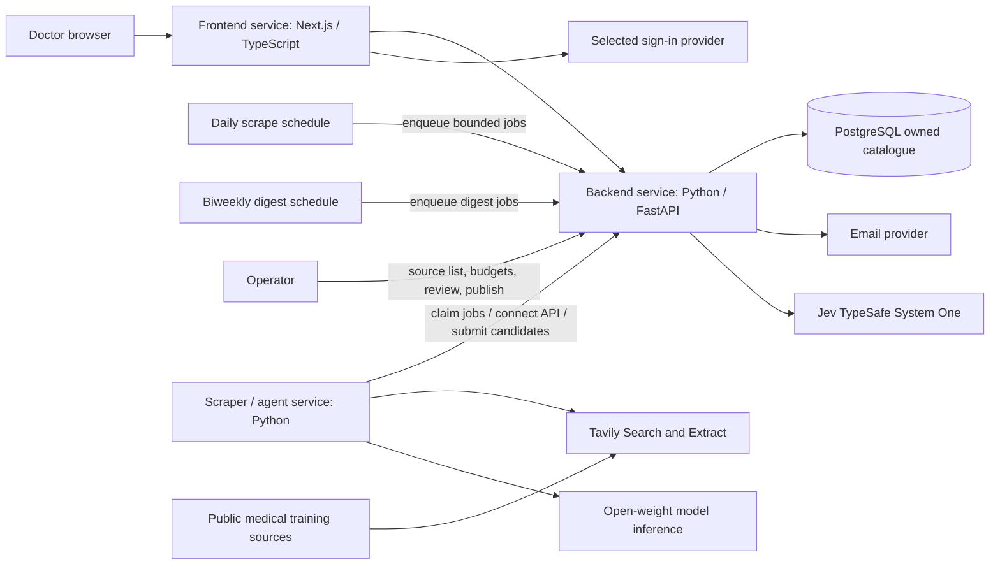

# CareCredits — spec-driven development specification

Version: 0.118 · 2026-09-29 · Status: implementation specification; portal and three-service split exist on this branch; DEC-09–11 and BUILD-09–11 are implemented. Functional requirements AUTH-01–CAT-02 have code/test evidence on this branch. DEMO-01 is split: offline FIXTURE path is implemented and labelled on `/live`; live Search/Extract + open-weight extraction remains owner-blocked without `MODEL_API_KEY` and `MODEL_OPEN_WEIGHT_CONFIRMED=true` (`scripts/demo_readiness.py`). Non-secret OPEN-03 model identity and I/O caps are sample defaults shown on operator integrations even when env fields are empty, labelled `OPEN-03 sample default (not a live run)` when `MODEL_ID` is unset (`model_identity_provisional`). Operator paid enqueue uses `paid_scrape_ready` from `/admin/services` (Tavily configured and model ready), matching the hourly auto daily-scrape tick. Operator POST `/admin/ingestion-jobs`, `/admin/daily-scrape`, and interrupted-job retry return 409 when Tavily is configured without a ready model, so curl cannot spend Tavily-only. The scraper worker also skips Search/Firehose when the open-weight model is not ready, so a queued Tavily-only job cannot spend. `/live` Overview and Learning record show recorded CPD as a number, not leftover circular meter chrome. Catalogue and suggestion rows use session dates instead of invented venue/people photos. Operators can send due NTF-01 digests from Training sources and `/live` without a Tavily call. Default CSRF origins include localhost:3020 and :3030 for extra Next instances. `scripts/demo_readiness.py` probes localhost candidate ports for `/health/live` so DEMO-01 step 1 can tell current CareCredits from a stale process or another app. Importing that module does not load `.env`; the CLI and an opted-in T-10 run call `load_owner_env()` so mocked tests cannot inherit owner TypeSafe or Firehose keys. Empty Search/Firehose jobs skip extract after the model is ready so an empty search is `succeeded`. Discover training shows Searching… instead of `0 training opportunities` while FIND-01 loads. `/live` suggestion detail waits for catalogue GET so a stub `{id}` is not shown as EVT-01 fields. Public profile, doctor catalogue JSON, CSV export, operator job sources, operator/detail source links, and operator model weight/licence links omit non-web URLs. Unmatched Next `/api/` paths (outside `/api/v1`) return `{error:{code,message,request_id}}`. Leftover unused vinext/site-creator starter files are gone. Leftover unused create-next-app public SVGs and leftover `codex-preview` metadata are gone. Missing Tavily configuration fails closed and points at `scripts/setup_integrations.py`. The optional T-08 live walk skips a running non-demo stack instead of failing documented demo credentials. When `DEMO_MODE=true`, login with the documented demo password reseeds `demo@` / `doctor@` if those fixture accounts were missing. The optional T-08 live walk targets a Next.js HTML shell (skip link) rather than a bare FastAPI port. First-paint skip-link lives only in the root layout so `/`, `/live`, and public pages do not emit a second skip control. A second Next.js instance stores `NEXT_DIST_DIR` under `frontend/.data/` so Turbopack will start. BUILD-08 / T-10 stay pending until that live run is recorded. OPEN-01 hackathon rules remain unverified.

This document expands the initial Tavily discovery specification using the owner's supplied meeting summary. It defines the full Malaysia MVP and the contracts needed to build it. It does not claim that the described application is already implemented.

## 1. Source of requirements and precedence

The meeting decisions are the product baseline. Earlier instructions additionally require actual Tavily API usage and mention a Nebius backend. The earlier design placed scraping inside FastAPI; **the meeting decision supersedes that target architecture: the scraper must become a separate Python service**. Existing adapter code should be reused during the move.

Spelling is normalized to **Tavily** from “Tavalli.” “DiveScript” is interpreted as JavaScript as stated in the summary. Retaining the existing TypeScript/Next.js frontend meets the JavaScript-based service decision; a rewrite to plain JavaScript is not required.

| ID | Confirmed owner/meeting requirement |
| --- | --- |
| DEC-01 | Three separately runnable application services: backend, frontend, scraper |
| DEC-02 | Python backend owns the primary PostgreSQL database |
| DEC-03 | Python scraper and JavaScript-based frontend |
| DEC-04 | Tavily API collects training data; real Search and Extract usage is required |
| DEC-05 | Initial geography is Malaysia; user-facing terminology is CPD |
| DEC-06 | Doctor sign-in, nearby discovery, sign-up tracking, attendance tracking and learning progress |
| DEC-07 | Show CPD points, prerequisites, beginner/intermediate/advanced difficulty, and fees |
| DEC-08 | Use open-weight models for application AI |
| DEC-09 | Own the Malaysia CPD catalogue: agents scrape public medical training sources on a daily schedule into CareCredits' database; doctors search that catalogue only. Paid Tavily/model calls are operator/agent budget, never per-user search. The product aim is to become the trusted default source of CPD training data |
| DEC-10 | Keep doctors engaged with their learning: track recorded credits, surface upcoming courses they should consider, email a digest every two weeks with upcoming events and prices plus current credit totals, and offer a printable CareCredits certificate doctors can send to organisations showing CareCredits affiliation and that their tracked credits are up to date on the platform |
| DEC-11 | Catalogue writes go through CareCredits **API connect endpoints** into the owned PostgreSQL database (no scraper direct DB writes). Before saving, call **Jev** (TypeSafe System One) against retrieved catalogue matches to decide whether an event already exists, is new, or is uncertain; **save new events** only when the judgment is `new` (or after operator review when uncertain). Exact URL/`source_key` matches remain deterministic short-circuits |

An implementation default below is a concrete proposal, not a recorded meeting decision. Defaults can be revised with a documented reason; they must not silently change confirmed requirements. Official hackathon rules, model eligibility, deadline and judging criteria are still unverified. Nebius remains an open dependency decision, not a cancelled requirement.

## 2. Product goal and success

Help doctors in Malaysia find relevant CPD training, maintain a personal record of activities they have signed up for and attended, stay informed about upcoming opportunities and their credit totals, and share a printable CareCredits affiliation certificate with organisations when asked.

The problem hypothesis is that opportunities and records are fragmented, and doctors lose track of what to take next; user research has not yet established its frequency or cost.

**Hackathon / core portal success:** a doctor can sign in, choose a Malaysian location, find a real source-backed training **from CareCredits' own catalogue**, inspect its points and practical requirements, open the provider's registration page, record a sign-up, mark attendance, and see the personal dashboard update without duplicating the activity or its points. Doctor search must not trigger a live Tavily call.

**Engagement success (DEC-10):** the doctor can see credit progress and suggested upcoming catalogue courses; receive an opted-in email every two weeks summarising upcoming events with prices and current recorded CPD totals; and download/print a CareCredits certificate stating platform affiliation and that their tracked credits are current on CareCredits. The certificate is **not** a regulator licence, MMC attestation, or independent verification of attendance.

Strategic product intent (DEC-09): CareCredits becomes the gold-standard Malaysia CPD dataset by continuously collecting and reviewing public medical training sources into PostgreSQL. Users come for the catalogue quality and freshness; operators control spend by budgeting daily scrape jobs instead of paying on every doctor keystroke.

**Catalogue write path (DEC-11):** the scraper/agent connects to the owned database only through backend API connect endpoints. After extraction, the backend loads likely existing sessions, asks **Jev** whether the candidate already exists, and saves new events into PostgreSQL when Jev returns `new`. Uncertain matches stay in the operator review queue instead of silently merging or duplicating.

The hackathon demonstration must additionally show a real Tavily Search → Extract run and a real open-weight model extraction run. Saved fixtures may support offline development but cannot substitute for those claims. Biweekly email and printable certificates may be demonstrated with fixtures or a single manual send if the mail provider is not yet live.

### MVP boundary

**Core portal (ship first):** sign-in, profile/location, database-backed discovery and filters, training detail, personal sign-up and attendance records, CPD progress, operator ingestion/review, source evidence, and loading/empty/error states.

**Engagement layer (DEC-10 — implemented on this branch):** optional biweekly digest emails, catalogue-based “consider next” course suggestions from the owned database (rule-based on city/mode/upcoming date — not a closed-weight recommendation engine), and printable affiliation certificates.

Implementation defaults:

- Sign-up means **recording that the doctor registered externally**. The app links to the provider; clicking the link alone does not register the doctor. Integrated booking/payment is outside MVP.
- Attendance is a reversible self-reported record. It is not independently verified completion or regulator-approved credit.
- Progress means signed-up count, attended count, and separately labelled recorded CPD totals. Optional personal notes support reflection; quizzes, competency scoring and an LMS are outside MVP.
- Online training is included only when a source establishes Malaysian relevance or participation eligibility. Global online training is not included merely because it is reachable from Malaysia.
- No automatic licence-renewal decision, universal legal annual target, accreditation guarantee, payment collection, or **certificate OCR of third-party documents**. CareCredits **may** issue its own printable affiliation certificate (DEC-10).
- Email digests are **opt-in**, every **14 days**, and use catalogue + personal progress data only — never a live Tavily call per recipient.
- “Courses you need to take” means **suggested upcoming catalogue sessions** filtered by the doctor's profile (e.g. city, mode) and recent activity gaps — not a claim that the doctor is non-compliant with any board.

## 3. Domain vocabulary

| Term | Definition |
| --- | --- |
| Training | A learning activity described by a provider |
| Session | One dated occurrence of a training; personal records attach to this occurrence |
| CPD points | User-facing label for advertised learning credits; it does not establish eligibility |
| Source credit label | Original provider wording, such as CPD, CME or CE, preserved alongside the UI label |
| Source | Original page URL and the retrieved evidence supporting an event field |
| Signed up | Doctor's record that external registration occurred |
| Attended | Doctor's self-reported participation in a session |
| Recorded points | Points the doctor explicitly records for attendance; distinct from advertised points |
| Verified | A specific claim reviewed against identified evidence, with reviewer and date |
| Unknown | Source does not establish a value; stored as null, never zero or a guessed value |
| Suggested training | Upcoming catalogue session offered to a doctor based on profile filters and gaps — advisory only |
| Biweekly digest | Opt-in email every 14 days with upcoming events, listed prices, and the doctor's current recorded CPD totals |
| Affiliation certificate | Printable CareCredits statement that the named doctor is affiliated with the platform and that their tracked credits were current as of the issue date; not a regulator document |

Calling credits CPDs in the UI does not imply that global schemes are equivalent or convertible. A source credit label that is not approved for aggregation remains visible but excluded from the CPD subtotal with an explanation.

## 4. Users and journeys

### Doctor

1. Sign in and create a profile; no claim of medical registration verification is made.
2. Select city/state or optionally consent to location access. Location denial does not block use.
3. Search upcoming trainings, filter by date, delivery mode, distance/location, cost, difficulty and advertised CPD points.
4. Open training details: provider, time, venue/online mode, prerequisites, difficulty, fees, advertised points, registration link and supporting sources. Unknowns are explicit.
5. Open the external registration link. Return and choose “Mark as signed up”; the portal records the user's assertion.
6. After the event, choose “Mark as attended,” optionally record points and notes, then inspect updated progress. Correcting attendance or points recomputes totals.
7. Opt in to biweekly digests; receive email updates on upcoming catalogue events (with prices where known) and current recorded CPD totals.
8. Review suggested upcoming courses from the owned catalogue when the portal highlights sessions to consider next.
9. Download/print a CareCredits affiliation certificate to share with organisations; the document states platform affiliation and tracked-credit currency, not board compliance.

### Operator

1. Configure server secrets locally or in deployment secret settings.
2. Maintain the curated set of Malaysia medical training sources / topics that the daily agent scrapes.
3. Inspect scheduled and manual ingestion jobs, status, usage and source coverage.
4. Review extracted candidates, ambiguous dates, missing fields, conflicts, duplicates and Malaysia eligibility.
5. Publish a source-supported session or reject/hold it with a reason. Publication is not accreditation verification.
6. Refresh a source; review material changes before updating published records. Daily scrapes propose updates; operators still gate publication.

## 5. Target architecture

| Component | Owns | Must not own |
| --- | --- | --- |
| Frontend | Sign-in experience, catalogue discovery, details, personal portal, digest preferences, certificate download, accessible UI | Tavily/model keys, operator token, direct database access, live scrape triggers, raw mail credentials, TypeSafe/Jev keys |
| Backend | Authentication enforcement, authorization, **owned CPD catalogue**, **API connect endpoints** to PostgreSQL, personal records, job state, scrape and digest schedules, validation, publication, persistence, progress, digest composition, certificate issuance, **Jev existence judgments** before save | Direct Tavily/model calls in the target architecture |
| Scraper / agent | Daily and manual job execution, Tavily adapter, extraction, open-weight model invocation, candidate construction; talks to catalogue only via backend connect/job APIs | Doctor records, **direct PostgreSQL credentials**, final publication decisions, doctor-facing search, email to doctors, TypeSafe/Jev keys (unless explicitly delegated) |
| PostgreSQL | Durable catalogue, personal, digest, certificate and ingestion records — the system of record users search | Public browser access |
| Email provider | Delivery of opted-in digests | Catalogue truth or publication decisions |
| Jev (TypeSafe) | Typed existence / duplicate / uncertain judgments over candidate vs catalogue match state | Generating event text, publishing, or bypassing evidence validation |

PostgreSQL is infrastructure, not a fourth application service. External identity, Tavily, open-weight inference, email, and TypeSafe/Jev are dependencies. Each application service needs its own entry point, container build and health check. **Only the backend has PostgreSQL write credentials.** The scraper connects through authenticated backend API endpoints (claim/complete plus catalogue connect/lookup/save). Completion and save are idempotent. A crashed worker cannot cause silent loss or double publication.

### Migration from the current branch

The transitional `backend/discovery.py` and `/discovery/search` operator endpoint have been removed. Tavily lives in `scraper/tavily.py`; jobs, candidates and publication stay on the backend. Do not reintroduce a synchronous public discovery route.

The earlier unauthenticated `/users/` endpoints and disabled-auth adapter are gone; doctor sessions and optional Google OAuth now own identity. A scraper bearer token does not solve user authentication.

## 6. Tavily and open-weight model pipeline

**Owned catalogue rule (DEC-09):** doctors and the public profile always read PostgreSQL. Tavily and the model run only inside scraper jobs started by operators or by the daily schedule. This is how CareCredits controls API credits and builds a durable gold-standard dataset instead of a pass-through search box.

**API connect + Jev existence (DEC-11):** the scraper never opens a database connection. It uses authenticated backend connect endpoints to look up catalogue rows and to save new events. Before insert, the backend asks Jev whether the candidate already exists in the retrieved match set.

1. A daily schedule (and optional operator run) enqueues bounded Malaysia-specific ingestion jobs for curated topics or known medical training sources.
2. Scraper claims the job and calls Tavily Search with bounded results against those sources / topics.
3. Canonicalize URLs conservatively, remove fragments, reject invalid/non-web/local URLs, and deduplicate exact source URLs. Do not strip meaningful query parameters.
4. Call Tavily Extract for the selected pages. Preserve snippets when extraction fails, with explicit failure status; snippet-only candidates remain in review and are not auto-published.
5. Send successful page text to the configured **open-weight model** to extract schema-conforming candidate sessions. Extract multiple sessions separately when a page describes several events.
6. Validate dates, values, enum fields and source excerpts deterministically. Model confidence does not prove correctness. Unsupported or malformed fields become null/review findings; do not repair them by inventing facts.
7. Scraper/backend **connect** to the owned catalogue via API: lookup by exact `source_key` / canonical URL first. If exact match → treat as **exists** (propose field updates for review; do not create a duplicate). If no exact match, retrieve a small set of near-neighbours (same provider/city/date window or fuzzy title) from PostgreSQL.
8. Call **Jev** (`POST https://api.typesafe.ai/v1/systemone`, model `jev-latest`) with dense state `{candidate, matches[]}` and a `choice` question whose criteria are `exists` / `new` / `uncertain`. Act on the typed answer and confidence threshold (default: require confidence ≥ 0.7 to auto-apply `exists` or `new`; otherwise force `uncertain`).
9. **Save new events** through the connect/save API only when the judgment is `new` and evidence validation passes — persist as a candidate awaiting publish, or as a published session when the operator policy allows auto-publish of high-confidence new rows (default: still operator-publish). `exists` links to the matched session and queues a refresh diff. `uncertain` lands in the operator review queue with the Jev probabilities attached.
10. Doctor searches use PostgreSQL only — never a paid Tavily or Jev request on search, filter, or page load.
11. Re-scrapes of the same source propose updates; material field changes require operator review before overwriting a published session.

The scraper uses Tavily for search/extraction and the open-weight model for structured interpretation. **Jev is used for catalogue identity judgments only** (exists vs new vs uncertain), not for generating event fields. Disable optional generated Tavily search answers in the application flow. Do not claim that Tavily's or TypeSafe's internals are open-weight: DEC-08 still governs application extraction AI; DEC-11 adds Jev as an explicit typed-decision dependency for deduplication.

**Default job design:** PostgreSQL-backed jobs owned by the backend; the scraper polls a claim endpoint. Claims are atomic, one worker owns a job lease, and completion/save are idempotent.

### Model selection contract

Before choosing a model, record its identifier/version, publisher, weights source, licence, hosting provider, structured-output support, context limit and evidence that the weights are available. Open-weight is not automatically the same as unrestricted open-source licensing.

The model must accept source text and return structured event candidates, handle relevant English/Malay text, preserve source-language evidence, and support the selected deployment budget. Run an evaluation against reviewed examples before adopting it. No closed-weight fallback is allowed silently. Model failure leaves evidence in review or marks the job partial/failed; a demo fixture must be labelled.

Earlier Nebius intent is preserved: confirm whether Nebius is required for inference, application hosting, or both before locking deployment. Keep `MODEL_BASE_URL`, `MODEL_ID`, and `MODEL_API_KEY` configurable; the scraper adapter is implemented. A live DEMO-01 run still needs owner keys.

## 7. Functional requirements

Statuses describe this branch: **existing** means implemented code, not live-provider verification; **planned** means required work.

| ID | Requirement | Acceptance criterion | Status |
| --- | --- | --- | --- |
| AUTH-01 | Doctor sign-in/out | Selected provider session is validated server-side; logout invalidates local session; unauthenticated personal requests return 401 | Existing email/password sessions; optional Google OAuth when `GOOGLE_CLIENT_*` are set (OPEN-04 still allows another provider). Login/register throttle uses `unknown` when the proxy omits a peer address, so the Next `/api/v1` walk does not 500. When `DEMO_MODE=true`, login with the documented demo password reseeds `demo@` / `doctor@` if those fixtures were missing or overwritten |
| AUTH-02 | Ownership isolation | A doctor cannot read or change another doctor's profile, registrations, attendance, notes or totals by changing IDs | Existing; covered by portal isolation tests |
| GEO-01 | Malaysia location | City/state entry works without GPS; exact coordinates are optional; non-Malaysian in-person events cannot publish | Existing city/state profile fields and catalogue filters; extraction rejects non-MY country |
| GEO-02 | Nearby search | Use distance only when user and venue coordinates exist; otherwise use city/state and show distance unavailable | Existing; distance is approximate and omitted when venue coordinates are missing |
| DISC-01 | Real Tavily Search | Bounded request uses Search for Malaysian medical training sources | Existing in scraper; live call unverified. Missing Tavily configuration fails closed and tells the operator to run `scripts/setup_integrations.py` |
| DISC-02 | Real Tavily Extract | Extract at most five unique returned URLs; empty Search results skip Extract | Existing in scraper (`include_answer` off); live call unverified. Empty Search skips Extract. A worker job checks open-weight model readiness before Search/Firehose, so a Tavily-only stack cannot spend credits on queued jobs. After Search plus optional Firehose fill, a job with no remaining sources skips extract so an empty search is `succeeded` |
| DISC-03 | Provenance | Preserve URL, retrieval time, source text and extraction outcome through candidate/publication flow | Existing on candidates; source text is operator-only |
| DISC-04 | Failure honesty | Partial extraction keeps evidence and warnings; provider failure is never fabricated success | Existing job statuses and warnings. Snippet-only pages and failed model extracts produce review candidates but are not auto-published through catalogue save. A missing model skips Search/Firehose instead of spending Tavily for heuristic review. Connect lookup/decide/save failures copy `{error.message}` into job warnings (not FastAPI `detail` / `None`) |
| DISC-05 | Bounded work | Query 3–300 trimmed characters; 1–5 search results; 30 seconds per Tavily call; no automatic paid retries | Existing; Firehose is skipped when Tavily already filled the job limit and otherwise only fills remaining slots, never a second set of five |
| AI-01 | Open-weight extraction | Approved open-weight model produces validated candidates with field-level excerpts and model/version metadata | Adapter existing; model choice and live run remain OPEN-03 / DEMO-01. Evidence-gated heuristic fallback accepts Malay `kursus`/`anjuran` pages without inferring points, fees or difficulty, and is used when extract fails or a page is snippet-only. A missing model skips Search/Firehose instead of spending Tavily for heuristic review |
| EVT-01 | Required training fields | Details show title, provider, session dates, delivery mode/location, CPD points, prerequisites, difficulty and fees; unknowns are explicit | Existing; flattened Course now also stores optional `end_date`, `timezone`, and `venue`. Heuristic extraction copies those only from explicit source phrases and never invents a timezone |
| EVT-02 | Event identity and updates | Same source/session does not duplicate; different sessions on one page remain distinct; ambiguous matches require review | Existing: `source_key` is `url|title|start_date`. Heuristic extraction now emits separate candidates for two weekday-titled dates on one page and still keeps a single title plus “DATE and DATE” as one session. Flattened `Course` is the intentional MVP of Training+Session (known merge limit: no shared training parent) |
| EVT-03 | Claim verification | Advertised points, publication and accreditation verification remain separate; verified claims have evidence/reviewer/time | Existing: operator publish writes `field_evidence` with reviewer/time and sets `source_reviewed`. Never accreditation |
| FIND-01 | Catalogue filters | Combine text, date, city/state or radius, mode, points, difficulty and fee filters with pagination; clearing filters resets results | Existing SQL filters on indexed columns; unknown dates/fees/points need `include_unknown`. `/live` exposes mode, period, difficulty, max fee, min points, state, radius, Near me, date from/to, include-unknown and pagination with Clear filters. Changing radius on the main workspace resets to page 1. `/live` search shows Searching… instead of `0 events` while FIND-01 results load, and Retry on an empty failed list. Discover training shows Searching… instead of `0 training opportunities` while the catalogue loads. `/live` catalogue, suggestions, learning records, and owner activity start loading so the first signed-in paint is not an empty list |
| REG-01 | Sign-up record | Explicit user action records external sign-up once per doctor/session; opening provider link does not create a record | Implemented `signup_status` `not_recorded` / `signed_up` / `cancelled`; cancelling does not erase attendance |
| ATT-01 | Attendance record | User can mark eligible past/started session attended and correct it; future sessions cannot be marked attended | Existing; optimistic versioning; corrections append `record_history` |
| PROG-01 | Personal progress | Selected-year counts and recorded points derive from attendance; corrections cannot double count; unknown/unapproved values are excluded and disclosed | Existing year dashboard with excluded-count disclosure; `/live` surfaces `excluded_reasons` beside the CPD total. Overview and Learning record show the recorded number as text — they are not a circular fill toward a legal annual target |
| PROG-02 | Suggested next courses | Portal shows upcoming owned-catalogue sessions filtered by doctor profile (city/mode) and recent gaps; copy is advisory (“consider”), never a compliance verdict | Implemented; city first, then the doctor's most recent attended delivery mode. `/live` “Consider next” reads `/me/suggestions` instead of repeating search hits, shows loading before empty, and Retry if that list fails. Opening a suggestion waits for GET `/trainings/{id}` so EVT-01 fields are not shown from a stub `{id}` Course |
| NTF-01 | Biweekly digest email | Opted-in doctors receive an email every 14 days with upcoming events, known prices, and current recorded CPD totals; unsubscribe works; no Tavily call per send | Implemented (MAIL_PROVIDER=log default; SMTP optional). Failed sends retry with a 15-minute to 24-hour backoff. GET `/api/v1/digest/unsubscribe` works without sign-in and returns HTML for email clients. Operators can send due digests from Training sources and `/live` without spending Tavily |
| CERT-01 | Printable affiliation certificate | Doctor can download/print a CareCredits PDF/statement naming them, issue date, recorded CPD total for the selected year, and clear non-regulator disclaimer; suitable to share with organisations | Implemented: default download is `application/pdf`; `?format=html` keeps the printable statement |
| UI-01 | Full portal | Sign-in, discovery, detail, signed-up/attended lists and progress have loading, empty, error and retry states | Existing Next.js portal: digest opt-in, suggestions, printable certificate, owner `/me/audit` on Overview, retry on catalogue errors, labelled demo fixtures. `/live` My Credits paginates My learning and Overview shows owner activity; operator review paginates candidates on `/` and `/live`. The `/live` review queue shows loading before empty and Retry if the candidate list fails, so DEMO-01 fixture cards are not hidden behind a false empty state. `/live` FIND-01, Consider next, My learning, and Overview activity start on a loading state so a restored session does not flash `0 events` / empty audit before the first fetch. Operator Ingestion on `/` loads with “Loading discovery jobs…” / “Loading review candidates…” rather than FIND-01 “Finding your training…”. Main-workspace My learning uses “Loading your records…” for the results heading and loading body, not FIND-01 “Finding your training…”. IntegrationStatus shows loading/error/retry for DEMO steps 1–2 and whether live discovery is ready, using `{error.message}` from the shared API helper. The Next `/api/v1` proxy returns `{error:{code,message,request_id}}` with 503 when the backend is unreachable instead of a raw fetch failure. Unmatched Next `/api/` paths outside `/api/v1`, and `/api/v1` with no extra path, return the same envelope with 404. `/live` listings use session date chips instead of invented venue or speaker photos. Leftover unused vinext/site-creator starter files (`vite.config.ts`, pnpm lockfiles, root `package-lock.json`, `.openai/hosting.json`) are removed |
| SEC-01 | Private secret setup | Hidden input saves ignored owner-readable `.env`; no key reaches frontend or logs | Existing `scripts/setup_integrations.py` records model publisher/host as well as keys; Tavily/model keys stay on scraper. Importing `scripts/demo_readiness.py` does not load `.env`; the CLI and `T10_LIVE=1` call `load_owner_env()` so mocked tests cannot inherit owner TypeSafe or Firehose keys |
| SEC-02 | Operator/service access | Doctor cannot start jobs or publish; scraper token cannot access personal data; missing integration configuration fails explicitly | Existing operator role and scraper bearer token |
| OPS-01 | Controlled ingestion | Durable leased jobs, bounded workers, pagination, usage metadata and an explicit run budget; doctor search never calls Tavily | Existing claim/heartbeat/complete plus explicit interrupted-job retry. A lost claim race retries the next queued job instead of returning 204 while work remains. Reported Tavily `usage.credits` and model `usage.total_tokens` are stored when the provider sends them; otherwise usage stays null |
| OPS-02 | Daily owned-catalogue scrape | A schedule enqueues bounded jobs for the curated Malaysia medical source/topic list once per day (timezone Asia/Kuala_Lumpur); usage is attributed to the operator budget; failures stay honest and never auto-replay paid calls | Existing: `backend/schedule.py` (per-topic `max_results` 1–5 on each job), lifespan tick, `POST /api/v1/admin/daily-scrape`, `config/scrape_topics.json` (site-scoped AFPM/MMA/hospital CME queries plus broader Malaysia GP CPD queries; ceiling still bounds spend). The hourly auto-tick no-ops until scraper health reports Tavily configured and the model ready. Operator enqueue/retry APIs return 409 when Tavily is configured without a ready model. Claimed jobs skip Search/Firehose when the open-weight model is not ready, so a queued Tavily-only job cannot spend. Job claim returns 204 in that same Tavily-only state so an old worker cannot pick the job up |
| CAT-01 | API connect to owned DB | Scraper/agent authenticates to backend connect endpoints; only the backend opens PostgreSQL; connect readiness fails closed if the DB is unreachable | Existing: `/internal/v1/catalogue/connect|lookup|decide|save`. `GET /health/ready` reports database readiness and returns 503 without leaking the driver error |
| JEV-01 | Jev existence judgment | For each validated candidate without an exact `source_key` match, backend queries Jev with candidate + match set; outcomes are `exists`, `new`, or `uncertain` with stored probabilities; doctor search never calls Jev | Implemented; live TypeSafe call uses `TYPESAFE_API_KEY` or `~/.typesafe/key`. Without the key, near matches stay `uncertain`. `POST /internal/v1/catalogue/decide` stores `_judgment` on an existing pending/held candidate. Operator review shows decision, confidence and probabilities |
| CAT-02 | Save new events | When judgment is `new` (or operator publishes an uncertain/new candidate), persist the event into the owned catalogue with evidence; never duplicate an exact `source_key` | Existing: `decision=new` defaults to a pending candidate (section 6 operator-publish). `CATALOGUE_AUTO_PUBLISH_NEW=true` publishes high-confidence new rows. `exists` holds a refresh candidate with `_refresh_diff`; operator publish applies the proposed fields to the matched session even if `source_key` drifted; uncertain stays held |
| DEMO-01 | Real demonstration | Show one live Search/Extract run, one eligible model run, published results and personal tracking flow; separate live from fixture evidence | **Fixture path existing** on this branch: DEMO_MODE seeds labelled courses, pending FIXTURE candidates, and personal records; `/live` banners and the Fixture review queue keep that evidence separate from live discovery (`scripts/demo_readiness.py`, `seed_demo.py`, `LiveIngestion`). `scripts/demo_readiness.py` probes localhost candidate ports for current `/health/live` (and Next skip-link HTML) versus stale or other apps, and labels unset OPEN-03 model identity as a sample default on the CLI. Documented `demo@` / `doctor@` login reseeds those accounts when `DEMO_MODE=true` even if a later unittest clobbered the sqlite file. **Live path pending / owner-blocked** until `MODEL_API_KEY` and `MODEL_OPEN_WEIGHT_CONFIRMED=true` are set; OPEN-03 model id, weights/licence URLs, publisher/host, and I/O caps are sample defaults (operator `/admin/integrations` and scraper readiness) labelled `model_identity_provisional` when `MODEL_ID` is unset, and do not count as a live run. Operator UI keeps bounded jobs, daily scrape, and interrupted-job retry off until Tavily and the model are ready. Operator APIs return 409 when Tavily is configured without a ready model |

## 8. Behavioural rules and defaults

### Discovery and location

- Default geography: country `MY`. A Malaysian webpage address alone is not proof of event location.
- Default time filter: upcoming sessions, ordered by next session start then stable ID. Unknown dates appear only when the user includes “Date not confirmed.”
- Nearby default: 25 km, selectable 10/25/50/100 km. These are product defaults, not meeting decisions. Calculate straight-line distance in the backend and label it approximate, not travel time.
- Without coordinates, use city/state matching. Online sessions have no distance; show them only when online/hybrid inclusion is selected and Malaysian relevance is established.
- Store timestamps in UTC when timezone is known and display Malaysian sessions in `Asia/Kuala_Lumpur`. Preserve date-only values as dates; do not invent a midnight time. Source timezone ambiguity stays in review.
- Difficulty is `beginner`, `intermediate`, `advanced`, or null. Do not infer it from points or price. Model suggestions without explicit source support remain review suggestions.
- Fees use decimal amounts and a currency code. Free means explicitly zero; unknown is null. MYR fee filters exclude other currencies and unknown values unless requested; no implicit currency conversion.
- Prerequisites may be source-supported text, explicitly “none stated by provider,” or unknown. Absence of text is not proof of no prerequisites.

### Personal tracking

Use separate fields `signup_status` (`not_recorded`, `signed_up`, `cancelled`) and `attendance_status` (`not_recorded`, `attended`). Attendance may be recorded without a prior sign-up because the doctor may discover an event retrospectively. Cancelling a sign-up does not erase past attendance.

A doctor can mark attendance when the session start has passed; date-only sessions become eligible on that local date. Unknown dates require the user to provide a non-future `attended_on` date. Corrections must preserve a change history. Marking attendance alone does not silently turn advertised points into earned points.

`recorded_points` is optional, nonnegative decimal, with `points_origin` (`self_reported`) and a preserved credit label. The selected-year dashboard sums only attended records with explicit eligible-to-aggregate CPD labels and known recorded points. Show excluded unknown/unmapped records separately. Removing attendance excludes its points while preserving correction history. No preset legal annual target or automatic CE/CME conversion is allowed. Which labels can aggregate is an operator-reviewed configuration, initially CPD only.

## 9. Data model

Use migrations and stable IDs. Existing integer user IDs may remain during migration; external identity references must be unique. All user-owned foreign keys derive from the validated session, not caller-supplied owner IDs.

| Entity | Core fields and constraints |
| --- | --- |
| DoctorProfile | user_id; identity_issuer + identity_subject unique; display_name; city/state; optional coordinates; location_consent_at; created_at |
| Training | id; title; provider_name; description; prerequisites nullable; difficulty nullable; created_at/updated_at |
| Session | id; training_id; start/end timestamps or date-only fields; timezone; mode; country/city/state/venue; nullable coordinates; fee_amount/currency; advertised_points; original_credit_label; registration_url; publication_status; cancellation_status. Flattened `Course` stores publication_status/cancellation_status; operator cancel hides the session from search without deleting personal records |
| SourceDocument | id; canonical_url; content_hash; retrieved_at; extraction_status; source excerpt/text; ingestion_job_id; unique URL+content hash |
| FieldEvidence | session/candidate reference; field_name; source_document_id; verbatim excerpt; reviewed_by/at nullable |
| Candidate | id; ingestion_job_id; source-local event key; structured payload; schema_version; model metadata; validation findings; review state/reason; resulting session_id nullable |
| DoctorSession | id; user_id+session_id unique; signup_status; attendance_status; signed_up_at; attended_on; nullable recorded_points; original_credit_label; points_origin; optional personal_notes; version |
| DigestPreference | user_id unique; opted_in; cadence_days default 14; last_sent_at; unsubscribed_at; fail_count; next_retry_at |
| DigestSend | id; user_id; sent_at; status; event_count; recorded_points_snapshot; provider_message_id nullable |
| AffiliationCertificate | id; user_id; year; recorded_points_snapshot; issued_at; document_hash; disclaimer_version |
| IngestionJob | id; request key; query; limits; status; attempt; lease token/expiry; timestamps; provider outcomes; measured usage if available; sanitized error |
| AuditEvent | actor; entity/action; timestamp; changed fields; no secrets; doctor history visible only to its owner/admin policy |

Database checks enforce nonnegative fees/points, valid enums, end not before start, exactly defined date precision, and duplicate personal-record prevention. Date-only and timestamp representations must not disagree.

Same URL can describe many sessions. Deduplicate source documents independently of event identity. Candidate matching considers provider, title, session date and location; uncertain matches are reviewed, not automatically merged. Refreshes create new evidence versions and do not overwrite a doctor's attendance/points. Published sessions are retained or cancelled rather than deleted out from under personal records.

## 10. Target API and service contracts

Routes in this section are implemented on this branch unless marked pending. JSON uses snake_case. Doctor authentication follows the selected identity provider; operator and scraper permissions are distinct. Mutation requests use server-side authorization and validation, including CSRF protection if cookie sessions are used.

| Method and route | Caller | Contract |
| --- | --- | --- |
| GET/PATCH `/api/v1/me` | Doctor | Read/update own location/preferences; no caller-supplied owner ID |
| GET `/api/v1/trainings` | Doctor | Query/filter catalogue; `page` >=1, `page_size` 1–50 (default 20); return items, total, page and applied filters |
| GET `/api/v1/trainings/{session_id}` | Doctor | Session detail, stored `field_evidence` excerpts, publication/review labels and registration URL. `source_url` and `registration_url` are omitted when missing or not a public http(s) web URL |
| GET `/api/v1/me/trainings` | Doctor | Filter own signed-up/attended records, paginated |
| PUT `/api/v1/me/trainings/{session_id}` | Doctor | Upsert signup/attendance, points and notes; version check prevents lost edits |
| GET `/api/v1/me/trainings/{session_id}/history` | Doctor | Owner-only correction history for one personal record; other accounts see an empty list |
| GET `/api/v1/me/progress?year=YYYY` | Doctor | Counts, recorded CPD subtotal, excluded-record count/reasons; no compliance verdict |
| GET `/api/v1/me/suggestions` | Doctor | Upcoming catalogue sessions to consider (city/mode filters); advisory copy only |
| GET/PATCH `/api/v1/me/digest` | Doctor | Read/update opt-in for the 14-day digest; unsubscribe sets opted_in false |
| POST `/api/v1/me/certificates` | Doctor | Issue a printable affiliation certificate for a selected year; returns download URL |
| GET `/api/v1/me/certificates/{id}` | Doctor | Download own previously issued certificate as PDF (`application/pdf`) or `?format=html` |
| GET `/api/v1/me/export/{kind}` | Doctor | Owner-only `csv` or `eml` export of personal records; notes stay off the public profile. CSV `source_url` is omitted when not a public http(s) web URL |
| GET `/api/v1/digest/unsubscribe` | Public | Signed-out HTML unsubscribe; sets opted_in false without a session |
| POST `/api/v1/admin/digests/run` | Operator | Send due opted-in digests now (NTF-01 backoff still applies); never calls Tavily. Training sources and `/live` expose Send due digests |
| GET `/api/v1/public/{slug}` | Public | Optional public learning profile; private notes never included. `source_url` is omitted when missing or not a public http(s) web URL |
| GET `/api/v1/me/audit` | Doctor | Owner-only audit rows for this account; notes and secrets omitted. Workspace Overview and `/live` Overview render this list |
| GET `/api/v1/admin/audit` | Operator | Paginated operator/admin audit trail; notes and secrets omitted. Training sources panel lists recent rows |
| GET `/api/v1/admin/candidates` | Operator | Paginated review queue |
| POST `/api/v1/admin/trainings/{session_id}/cancel` | Operator | Hide a published session from search; retain personal records |
| GET `/api/v1/admin/scrape-topics` | Operator | Read-only curated daily topic list, ceiling, and local day. Edit remains `config/scrape_topics.json` |
| POST `/api/v1/admin/daily-scrape` | Operator | Enqueue today’s curated topic jobs (OPS-02); `force=true` re-queues idle jobs. 409 when Tavily is configured without a ready model |
| POST `/api/v1/admin/ingestion-jobs` | Operator | `{query,max_results}`; require Idempotency-Key; return 202 + job_id/status. 409 when Tavily is configured without a ready model |
| GET `/api/v1/admin/ingestion-jobs` | Operator | Recent jobs for the operator workspace; no credentials |
| GET `/api/v1/admin/ingestion-jobs/{id}` | Operator | State, counts, warnings and usage; no credentials |
| POST `/api/v1/admin/ingestion-jobs/{id}/retry` | Operator | Re-queue an `interrupted` job only; 409 otherwise; never auto-replays paid calls. 409 when Tavily is configured without a ready model |
| GET `/api/v1/admin/integrations` | Operator | Model identity, publisher/host, weights/licence URLs, confirmation/caps/key flags, `model_identity_provisional` when `MODEL_ID` is unset (OPEN-03 sample default), `model_caps_provisional` when I/O caps are unset, `model_weights_provisional` / `model_license_provisional` when those URLs are unset, Jev and scraper-token presence, and whether `new` events auto-publish. Never returns secret values |
| GET `/api/v1/admin/services` | Operator | Backend/database/scraper readiness for DEMO-01 step 1. Database owner is `backend`. Scraper flags are reachable/Tavily configured/model ready only; `paid_scrape_ready` is true only when Tavily is configured and the model is ready. No secrets or missing-env names |
| POST `/api/v1/admin/candidates/{id}/review` | Operator | publish/reject/hold, reason, version and evidence-backed corrections. Hold and reject require a reason of at least 3 characters. Corrections require a verbatim `evidence` excerpt from the stored source text |
| POST `/internal/v1/jobs/claim` | Scraper | Atomically lease one queued job; 204 if none; return lease_token and bounded job payload |
| POST `/internal/v1/jobs/{id}/heartbeat` | Scraper | Matching lease token extends lease within job deadline |
| POST `/internal/v1/jobs/{id}/complete` | Scraper | Matching lease + candidate batch + outcomes; idempotent completion |
| GET `/internal/v1/catalogue/connect` | Scraper | Readiness: confirms backend↔PostgreSQL connect for catalogue writes; 503 if DB unavailable; no secrets in body |
| POST `/internal/v1/catalogue/lookup` | Scraper / Backend | `{candidate}` → exact `source_key` hit and/or near-neighbour sessions for Jev state; never returns other doctors' personal data |
| POST `/internal/v1/catalogue/decide` | Backend (or scraper via backend) | Runs Jev existence choice over `{candidate, matches}`; returns `{decision, confidence, probabilities, matched_session_id?}`; stores judgment on the candidate |
| POST `/internal/v1/catalogue/save` | Scraper / Backend | Saves a **new** event when decision is `new` (or operator-approved); 409 on exact duplicate; queues update diff when `exists` |
| GET `/health/live` and `/health/ready` | Infrastructure | Liveness independent of paid providers; readiness reports required local configuration/connectivity including DB connect. Backend, scraper, and Next all expose `/health/live` as `{status: live}` (backend and scraper `/health` stay a generic `{status: ok}` ping). Frontend `/health/ready` probes backend `/health/ready` and returns the SDD envelope on 503. Unmatched scraper health paths use `{error:{code,message,request_id}}`. Compose frontend healthcheck uses `/health/live`. `scripts/dev.py` waits for all three `/health/live` checks before printing the ready line |

Catalogue query fields: `q`, `city`, `state`, `latitude`, `longitude`, `radius_km`, `date_from`, `date_to`, `mode`, `difficulty`, `min_points`, `max_fee_myr`, `include_unknown`, `page`, `page_size`. Coordinates must be supplied together; radius requires coordinates. Incompatible/invalid filters return 422. Filtering by points or fees excludes unknowns unless explicitly included.

Normal responses are 200/201; jobs use 202. Return 401 for missing authentication, 403 for wrong role, 404 for unavailable or other-user records, 409 for version/idempotency conflict, 422 for invalid values and 429 for application throttling. Use a stable `{error:{code,message,request_id}}` envelope for target endpoints, including unmatched `/api/` routes (Starlette routing 404s); never leak provider bodies or internal stack traces.

DoctorSession PUT represents the desired full state and includes the last-read `version` (0 for creation). Repeating an already-applied identical request returns the current record; a stale request that would change current state returns 409. DB uniqueness protects concurrent first writes. Missing source points do not prevent recording attendance.

### Job durability and limits

States: `queued → running → succeeded | partial | failed`; expired leases become `interrupted`, requiring an explicit operator retry with a new attempt. Do not automatically repeat paid calls after an ambiguous crash. Reusing the same idempotency key and body returns the same job; a different body returns 409. Completion checks lease ownership and stores candidates and terminal status in one transaction.

Defaults: one active worker, five source pages per job, maximum ten manually started jobs per operator per hour, 120-second lease with heartbeat every 30 seconds, five-minute total deadline. A deadline mid-loop completes the job as `partial` and keeps extracted candidates plus reported usage. Apply per-call timeouts within that deadline. Model input/output caps are set after model selection; missing caps block model job readiness. These bounds limit work, not a guaranteed monetary spend. Record reported usage when available; unknown usage is null.

**Daily schedule (DEC-09 / OPS-02):** enqueue one bounded job per curated topic or source family per day in `Asia/Kuala_Lumpur`, with an operator-configurable daily credit/job ceiling. The schedule creates the same job records as manual runs; it does not bypass leases, idempotency, or review. The hourly auto-tick no-ops until scraper health reports Tavily configured and the open-weight model ready, matching the operator UI spend gate. Operator POST enqueue and interrupted-job retry return 409 when Tavily is configured without that model, so a Tavily-only curl cannot spend. A claimed job also skips Search/Firehose until the open-weight model is ready. Missed days do not catch up by blasting unpaid backlog — operators choose whether to backfill. No doctor-facing “live scrape this query now” control in MVP.

**Biweekly digest schedule (DEC-10 / NTF-01):** every 14 days in `Asia/Kuala_Lumpur`, the backend selects opted-in doctors whose `last_sent_at` is due, composes a digest from the owned catalogue (upcoming sessions with known/unknown prices labelled) plus that doctor's progress snapshot, and sends through the configured email provider. Failures are logged and retried with a bounded backoff; never call Tavily to personalize a digest. Unsubscribe links must work without signing in.

## 11. Existing implementation and evidence

This branch implements the three-service target: FastAPI owns PostgreSQL (or SQLite demo), the scraper owns Tavily plus model extraction, and the Next.js portal talks only to `/api/v1`. The transitional `POST /discovery/search` adapter was moved to `scraper/tavily.py` and the synchronous operator endpoint was removed rather than given a job-shaped response.

Doctor journeys use httponly session cookies, CSRF origin/`X-Care-Client` checks (mutations require an allowlisted Origin), catalogue filters, personal sign-up/attendance records, year progress, catalogue suggestions, opt-in biweekly digests, printable affiliation certificates, city/state profile, and an optional public profile. The main workspace (`/`) now exposes digest/suggestions/certificate; `/live` remains a compact demo shell with three-service/database readiness (loading/error/retry on integration status), operator integration status, bounded job start, candidate review/publish (DEMO-01 steps 1–4; DEMO_MODE seeds labelled pending candidates for offline review), doctor city/state save, FIND-01 mode/period/difficulty/fee/points/state/radius/Near me/date from-to/include-unknown filters with clear and pagination, optional public profile and CSV export, PROG-01 excluded-reason disclosure, PROG-02 “Consider next” suggestions, progress year selector, My learning signed-up/attended lists, catalogue search/detail, and personal tracking controls that never spend Tavily on doctor search. Operators create idempotent ingestion jobs; the scraper claims a 120-second lease. When the open-weight model is not ready, claim returns 204 and a claimed worker skips Search/Firehose so a Tavily-only stack cannot spend. When the model is ready, the worker calls Tavily Search/Extract and stores source URLs on the job. Candidates still require source excerpts before publish. Interrupted jobs stay interrupted until `POST /api/v1/admin/ingestion-jobs/{id}/retry`. Daily scrape enqueue (OPS-02) and catalogue connect/lookup/decide/save with Jev (DEC-11) are wired. Live TypeSafe uses `TYPESAFE_API_KEY` when set. Open-weight model DEMO-01 still requires owner model keys.

Mocked tests cover Tavily bounds, extraction validation, two-user isolation, filter semantics, nearby city fallback, unknown-value inclusion, explicit job retry, digest opt-in/unsubscribe/send, suggestions, certificates, error envelopes, cancelled signup, and Google OAuth start. They do not spend API credits. No live open-weight model run has been recorded (DEMO-01). Identity is local email/password plus optional Google OAuth. Candidate `hold` and `reject` require a review reason and stay out of the catalogue until publish. Target `{error:{code,message,request_id}}` envelopes and cancelled `signup_status` are implemented. Demo fixtures load only when `DEMO_MODE=true` outside production, are labelled fictional, include past sessions for attendance rehearsal, and expose a labelled provider registration URL for DEMO-01 step 6.

## 12. Security, privacy and operational requirements

- Prefer the existing repository's intended third-party OAuth direction; select a provider before implementing sign-in. Validate token issuer/audience/session expiry. Never accept an arbitrary email or user ID as identity proof.
- Separate doctor, operator and scraper permissions. Scraper cannot read personal profiles, notes or attendance. Frontend cannot obtain service tokens.
- After the service split, give Tavily/model secrets only to scraper; give database credentials only to backend. Restrict browser origins and internal endpoints. Origins default to localhost ports 3000, 3010, 3020, 3021, and 3030 (isolated Next instances); there is no wildcard CORS middleware. Unauthenticated `/users/` routes are gone.
- Collect city/state by default; exact location is optional. Do not put precise location, user identity, notes or patient data into Tavily/model prompts. Training discovery needs public event information only.
- Render source text as escaped text/sanitized content. Model output cannot issue tool calls, change authorization or publish itself. Reject unsafe links on publication even if Tavily returned them.
- Retain retrieval metadata and evidence required to explain listings. Default raw-page retention is 30 days (`purge_expired_source_text`): unreferenced `SourceDocument` rows are deleted, referenced snippets and candidate/course `source_text` plus job source snippets are blanked, and reviewed `FieldEvidence` excerpts stay while the listing needs them, subject to source terms and a documented privacy/retention review before a pilot.
- Log request/job IDs, counts, sanitized failures, durations and reported usage. Do not log API keys, bearer tokens, personal notes or raw identity tokens.
- Backend readiness checks PostgreSQL; scraper readiness checks required configuration without making a paid call. Provider outage must not make stored catalogue browsing fail.
- Proposed performance target: catalogue reads under one second at p95 on a seeded 1,000-session dataset with 10 concurrent readers, excluding external sign-in. Measured 2026-09-28 in `test_catalogue_perf.py` on Darwin arm64 via in-process TestClient + SQLite: p95 0.110s (max 0.113s, n=10). This is not a live three-service or PostgreSQL observation.

## 13. Verification plan and traceability

| Test ID | Requirement IDs | Scenario and pass condition |
| --- | --- | --- |
| T-01 | AUTH-01, AUTH-02, SEC-02 | Sign-in/out plus two-user isolation; changing record IDs never exposes another user's data; doctors cannot ingest or publish. Certificate download is owner-only (404 for another account). Record history is owner-only (empty list for another account) |
| T-02 | DISC-01, DISC-02, DISC-05 | Mock Search/Extract contract; deduplicate URLs; no Extract on empty Search; input/result/time bounds preserved after migration |
| T-03 | DISC-03, DISC-04, OPS-01 | Partial extraction, malformed payload, missing key, timeout, 401/429/credit limits, process crash; preserve evidence and accurate terminal state. Adapter mapping is in `test_discovery.py`; `run_job` timeout/credit-limit failure, heartbeat extend, expired-lease-does-not-publish, and deadline-keeps-candidates-and-usage are covered |
| T-04 | AI-01, EVT-01, EVT-03 | Reviewed 20-page fixture set including English/Malay, missing fees/points, several sessions, ambiguous dates and malicious instructions; all accepted outputs schema-valid, every published non-null factual field has supporting evidence, no unsupported points/fees published. Mocked model path plus an unmocked heuristic pass over the 10 in-scope pages (at least 8 usable, no invented points/fees) are in `backend/tests/test_t04_fixtures.py`; live model accuracy remains DEMO-01 |
| T-05 | EVT-02, OPS-01 | Re-import same page, changed content, several sessions per page, expired lease, duplicate completion and concurrent workers; no double publication or silent merge. Covered by `test_two_sessions_on_one_page_stay_distinct`, `test_heuristic_keeps_two_titled_sessions_distinct`, `test_changed_content_queues_refresh_without_duplicate`, `test_exists_refresh_updates_matched_course_when_source_key_drifts`, `test_expired_lease_complete_does_not_publish`, `test_concurrent_complete_does_not_duplicate_candidates`, concurrent claim, and `test_concurrent_worker_stress_does_not_duplicate` (8 workers drain 8 jobs with one owner and one candidate each) |
| T-06 | GEO-01, GEO-02, FIND-01 | Malaysia/non-Malaysia, radius boundary, denied location, missing venue coordinates, online eligibility, unknown fees and pagination; results match defined filters. Catalogue listing now excludes `country != MY` and cancelled sessions; pagination and cancel-retain-records are in `test_catalogue_paginates_and_hides_non_malaysia_or_cancelled`. `max_fee_myr` excludes non-MYR prices even when `include_unknown` is set. Radius values outside 10/25/50/100 return 422 |
| T-07 | REG-01, ATT-01, PROG-01 | Link click does not sign up; repeated save does not duplicate; future attendance rejected; corrections and year boundary recalculate once; unknown/unmapped credits excluded visibly |
| T-08 | UI-01 | Keyboard-accessible sign-in/search/detail/portal, readable mobile layout, loading/empty/error states and retry; no fake success toast. Skip links stay in tab order via visually-hidden-until-focus (`left:8px`; hidden via `:not(:focus):not(:focus-visible)` clipping so focus styles cannot be overridden by more-specific base rules). Detail dialog focuses on open, traps Tab, and closes on Escape (`TrainingDetail`). A 2026-09-28 source/CSS pass records those behaviours. Leftover template donut/match/category CSS is removed from `/live` `dash.css`. Leftover unused shadcn `components/ui` kit, leftover shadcn npm packages, leftover unused vinext/site-creator starter files, leftover unused create-next-app public SVGs, and leftover `codex-preview` metadata are removed from the tree. Overview/Learning record rings no longer use a hardcoded 60% conic fill. `/live` Overview and Learning record no longer use leftover circular `ring` / `score` chrome; they state the recorded CPD total instead of a meter. Main-workspace Overview no longer uses leftover circular `orbit` / `hero-art` chrome. Catalogue rows on `/` and `/live` use session date chips instead of invented venue or speaker photos. `test_t08_live.py` walks a running Next.js frontend (`T08_FRONTEND_URL` or `:3030`/`:3021`/`:3020`/`:3010`/`:3000` HTML with a skip link, `/health/live` `{status: live}`, plus `/api/v1/config`), not a bare FastAPI port. Identification uses unauthenticated `GET /api/v1/me` (401/403) so a stale backend missing `/me/audit` cannot hide a current Next shell. It loads `/` and `/live` HTML skip links, then progress, suggestions, digest, export, certificate, history, and owner audit when `GET /config` reports `demo`. A non-demo stack or failed documented login is skipped. The first-paint skip-link is the root layout control targeting `#main-content`; page shells keep that id and do not add a second skip link. A 2026-09-28 accessibility snapshot of the isolated Next shell listed “Skip to content” as the first page link; a native visible-focus Tab keystroke still could not be recorded through this automation |
| T-09 | SEC-01, SEC-02, OPS-01 | Check built client assets/logs for test secrets, internal route access, database ownership, origin policy and spending limits. Source-tree scan (`test_source_tree_omits_live_secret_values`), origin default, built-asset scans of `frontend/.next` plus second-instance `frontend/.data` dist dirs, and a `.data` runtime log scan are covered by `backend/tests/test_t09_secrets.py`. A 2026-09-28 production `next build` is present so the built-asset scan runs instead of skipping |
| T-10 | DEMO-01, AI-01 | Real Tavily and selected open-weight inference calls; preserve redacted request evidence and model identity; demonstrate publish/search/track flow. `backend/tests/test_t10_live.py` is the live harness: it skips unless `T10_LIVE=1` and `scripts.demo_readiness.live_ready()` after `load_owner_env()`; a passing default suite is not a live T-10 claim. When opted in it runs one bounded Search/Extract (`max_results=1`) plus model extraction and writes redacted evidence to `.data/t10-evidence.json` |

T-04 reports field accuracy and rejection rate in addition to its publication gate; a review step must not conceal a nonfunctional extractor. Empty/rejected output for all pages does not pass. Require correct usable candidates from at least 8 of 10 clearly specified, in-scope event fixtures; include the other 10 as edge/negative cases.

Mock tests run without secrets. Importing `scripts/demo_readiness.py` does not load `.env`; the CLI and an opted-in T-10 run call `load_owner_env()`. Live tests are separate, explicitly use configured keys and consume credits. Do not claim live success from passing mocks. End-to-end tests use an isolated test database and two doctor accounts. Test failure/error states as well as the happy path.

## 14. Build plan

| Task | Dependencies | Deliverable and definition of done |
| --- | --- | --- |
| BUILD-01 | None | OPEN-02/03/04 have provisional DEMO-01 answers (Nebius for inference only; Qwen3-30B-A3B on Token Factory; Google OAuth plus local email). OPEN-01 hackathon rules and OPEN-09 deadline/budget remain unverified; do not claim judged compliance. Live T-10 still needs owner keys |
| BUILD-02 | None | Existing on branch. Split Python scraper from backend; add containers, narrow secrets, durable job schema/contracts; mocked T-02/T-03 pass; interrupted-job retry added; concurrent-worker stress covered by `test_concurrent_worker_stress_does_not_duplicate` |
| BUILD-03 | BUILD-01 identity choice | Existing local sessions and isolation tests; optional Google OAuth implemented. Another provider remains OPEN-04. Unauthenticated user endpoints removed |
| BUILD-04 | BUILD-01 model choice, BUILD-02 | Adapter, evidence gate, and mocked T-04 20-page fixture evaluation exist; live accuracy still DEMO-01 |
| BUILD-05 | BUILD-02, BUILD-04 | Existing publish + SQL catalogue filters on indexed columns; evidence remains in JSON. Flattened `Course` is the documented MVP of Training+Session |
| BUILD-06 | BUILD-03, BUILD-05 | Existing records and progress; `signup_status` includes cancelled; `record_history` stores corrections |
| BUILD-07 | BUILD-03, BUILD-05, BUILD-06 | Existing portal including digest/suggestions/certificate and retry; demo fixtures labelled; T-09 built-asset scan exists; dialog focus trap, Escape close, and public skip-link focus reveal are covered by source/CSS tests (`test_t08_ui.py`). The optional T-08 live walk requires Next.js HTML (skip link) rather than a bare backend port. Native Tab keystroke recording remains an automation limit |
| BUILD-08 | BUILD-01–07 | Not started for the live three-service + T-10 claim. Fixture/offline demo shell exists on `/live`. Blocked on owner model keys (and OPEN-01 rules for a judged submission) |
| BUILD-09 | BUILD-02, BUILD-05, OPEN-05, OPEN-09 | Done. Curated `config/scrape_topics.json` + daily enqueue (OPS-02) with `DAILY_SCRAPE_JOB_CEILING`; doctors search the owned catalogue only |
| BUILD-10 | BUILD-06, OPEN-10 | Done. Digest preferences + biweekly send (NTF-01), catalogue suggestions (PROG-02), printable affiliation certificate (CERT-01) with non-regulator disclaimer. Default mailer is file log; set MAIL_PROVIDER=smtp for real email |
| BUILD-11 | BUILD-02, BUILD-05, OPEN-11 | Done. Connect/lookup/decide/save exist; exact `source_key` short-circuits; no matches → `new` (pending by default; `CATALOGUE_AUTO_PUBLISH_NEW=true` still auto-publishes); live Jev when `TYPESAFE_API_KEY` is set; near matches without the key stay `uncertain` |

Do not estimate a delivery date until team size and remaining hackathon time are known. If time is short, propose reducing optional polish or tracking detail; do not silently drop the three-service, Tavily, open-weight, Malaysia, personal-tracking, owned-catalogue (DEC-09), engagement (DEC-10) or Jev-gated connect/save (DEC-11) decisions.

## 15. Demo script and completion gate

1. Show the three running application services and backend-owned database.
2. Show configured integration status without revealing secrets; identify the selected open-weight model and its weights/licence evidence.
3. Run a bounded real Malaysia training ingestion job; show Tavily source URLs and extraction outcome.
4. Inspect model-produced candidates and field evidence; review and publish one suitable session.
5. Sign in as a doctor, select a Malaysian location, filter and inspect the published training.
6. Open provider registration; explicitly record sign-up; demonstrate attendance on a past session and recorded-point correction.
7. Show updated personal progress and explain self-reported versus verified information.

Release gate: confirmed meeting requirements have working implementations and linked passing tests; official hackathon requirements are checked; secrets are absent from client/logs/repository; real API/model use is evidenced; placeholders are labelled or removed; failures do not fabricate success. Unfinished items remain explicitly listed.

## 16. Open decisions

| ID | Question | Working position / impact |
| --- | --- | --- |
| OPEN-01 | Which hackathon and exact rules? | Owner requirements guide work; official eligibility/submission requirements still need verification |
| OPEN-02 | Required Nebius role? | **Provisional for DEMO-01 (2026-09-20):** Nebius Token Factory used for **inference only**. Application hosting remains local Docker/dev; not yet Nebius-hosted. |
| OPEN-03 | Which open-weight model/host/licence? | **Provisional DEMO-01 choice (2026-09-20):** Nebius Token Factory host; model `Qwen/Qwen3-30B-A3B-Instruct-2507`; weights https://huggingface.co/Qwen/Qwen3-30B-A3B-Instruct-2507 ; licence https://huggingface.co/Qwen/Qwen3-30B-A3B-Instruct-2507/blob/main/LICENSE (Apache 2.0 per model card family). Owner still must run `setup_integrations.py`, set keys, and confirm `MODEL_OPEN_WEIGHT_CONFIRMED=true`. |
| OPEN-04 | Identity provider? | Google OAuth implemented as the first third-party provider (`GOOGLE_CLIENT_ID` / `GOOGLE_CLIENT_SECRET`). Email/password remains for local demo. |
| OPEN-05 | Which providers/accreditation sources? | **Working position (2026-09-24):** build a curated Malaysia medical training source list that the daily agent scrapes into the owned catalogue (DEC-09). Start with public conference/CME portals and known associations; no automatic official eligibility claim |
| OPEN-06 | Does sign-up mean integrated registration? | Default is external registration plus personal record; integration would expand scope |
| OPEN-07 | What proves attendance and credits? | Self-report MVP. CareCredits may issue an **affiliation certificate** (DEC-10 / CERT-01) stating platform-tracked credits; it is not MMC/regulator proof. Third-party verification remains a later decision |
| OPEN-08 | Location/geocoding source and approved online scope? | Manual city/state works first; no geocoder vendor chosen |
| OPEN-09 | Team, deadline, credit budget and hosting? | Required to prioritize work and set daily scrape ceilings |
| OPEN-10 | Email provider for biweekly digests? | Partially resolved: `MAIL_PROVIDER=log` writes digests under `.data/digests/` for local/demo; set `smtp` + SMTP_* for production sends |
| OPEN-11 | TypeSafe / Jev credentials and confidence floor? | Store `TYPESAFE_API_KEY` on the backend only (or `~/.typesafe/key`). Auto-apply confidence floor defaults to 0.7 via `JEV_CONFIDENCE_FLOOR`. |

## 17. Recommended next steps (owner-facing)

Ordered for a strong hackathon demo without dropping confirmed DEC-01–11 scope.

1. **Lock remaining BUILD-01 answers (OPEN-01, OPEN-09).** OPEN-02/03/04 are provisional. Without official hackathon rules and a deadline/budget, BUILD-08 cannot be claimed complete.
2. **Prove DEMO-01 with real credits.** Still owner-blocked. One live Tavily Search→Extract job and one live open-weight extraction on a Malaysia CPD query; keep redacted evidence. Mocked tests stay separate.
3. **Seed the owned catalogue (DEC-09).** Done on this branch: curated `config/scrape_topics.json`, doctor search on PostgreSQL only. Live scrape still needs owner keys.
4. **Wire catalogue connect + Jev decide/save (DEC-11 / BUILD-11).** Done. Live Jev still needs `TYPESAFE_API_KEY`.
5. **Schedule the daily agent (BUILD-09 / OPS-02).** Done, with operator ceiling and topic inspect UI.
6. **Engagement layer (DEC-10 / BUILD-10).** Done (log mailer default; SMTP optional).
7. **Finish operator review polish that demo depends on.** Done: hold/reject require a reason; `scripts/happy_path_review.py` covers reject → hold → publish.
8. **Close personal-tracking gaps that judges will poke.** Done: cancelled signup, attendance history, and self-report ≠ regulator copy.
9. **Schema honesty pass.** Done as documentation: flattened `Course` is the intentional MVP of Training+Session. Identity is `source_key=url|title|start_date`; a later parent Training table can group sessions without changing doctor APIs.
10. **Identity path.** Keep local email/password for internal demos if needed, but decide OAuth (OPEN-04) before any doctor pilot outside the team.
11. **Hardening before any shared URL.** CSRF/origin already present (localhost 3000/3010/3020/3021/3030); T-09 source and a 2026-09-28 built `.next` scan omit service secret names; T-08 native Tab keystroke recording remains an automation limit. CORS stays localhost-only.
12. **Do not expand MVP** into payments, third-party certificate OCR, auto licence compliance, per-user live Tavily search, or silent closed-weight models.

### Owner priority (2026-09-20)

Owner selected **Prioritize live DEMO-01 (real Tavily + model)** as the immediate focus. Other OPEN-* items stay unresolved; do not block the live run on OAuth or schema split. Record redacted evidence for T-10 once the run succeeds.

### Working priority until owner answers

Owner override in effect: DEMO-01 live evidence is the active priority. Operator polish and labelled gaps follow only if they unblock that demo. Do not invent hackathon compliance or Nebius usage.

## 18. Owner questions (to resolve OPEN-*)

Answer these in chat; decisions will be written back into section 16 with dates.

| Ask | Maps to | Why it matters |
| --- | --- | --- |
| Which hackathon (name + link) and what is the hard deadline? | OPEN-01, OPEN-09 | Rules and time box every cut |
| Must we use Nebius for inference, hosting, both, or neither? | OPEN-02 | Locks hosting and model path |
| Preferred open-weight model + host if you already have one (else “recommend”) | OPEN-03 | Unblocks AI-01 / T-04 / DEMO-01 |
| Sign-in for demo: keep local email/password, or force OAuth now (Google / other)? | OPEN-04 | AUTH path for judges vs pilots |
| Who is the primary audience for the next two weeks: judges, MKIS/doctors, or internal only? | product | Changes polish vs compliance tone |
| Approximate Tavily + inference budget you are willing to spend on demos and on the daily scrape | OPEN-09 | Caps live job size and OPS-02 ceiling |
| Is external registration + self-report still correct, or do you want integrated booking later? | OPEN-06, OPEN-07 | Protects MVP boundary |
| Any must-include Malaysian source domains or boards for the curated daily scrape list? | OPEN-05, DEC-09 | Seeds the owned catalogue |
| Which email provider / from-address for biweekly digests? | OPEN-10, DEC-10 | Unblocks NTF-01 |
| TypeSafe API key ready, and confidence floor for auto exists/new (default 0.7)? | OPEN-11, DEC-11 | Unblocks Jev catalogue decide/save |
| Geocoding: stay manual city/state for MVP, or pick a vendor now? | OPEN-08 | Nearby search quality |

## 19. References and change log

- Product source: owner's meeting summary supplied in this task; DEC-01–11 preserve its decisions (DEC-09–11 added 2026-09-24).
- [Tavily Search API](https://docs.tavily.com/documentation/api-reference/endpoint/search)
- [Tavily Extract API](https://docs.tavily.com/documentation/api-reference/endpoint/extract)
- [TypeSafe / Jev System One](https://docs.typesafe.ai/llms.txt)
- Repository evidence: `backend/main.py`, `backend/portal_models.py`, `scraper/tavily.py`, `scraper/extraction.py`, `frontend/app/page.tsx`, `docker-compose.yml`.

v0.1 established Tavily discovery inside the backend. v0.2 supersedes that target with the confirmed three-service design, adds open-weight extraction, defines the complete doctor portal and tracking rules, and preserves the distinction between existing code and planned requirements. Tavily API contracts were checked during the preceding implementation; this revision does not independently verify hackathon rules or Malaysian regulatory requirements. v0.3 records the uncommitted portal/scraper implementation on `feat/gp-portal`, updates requirement statuses, and notes remaining DEMO-01 / OPEN-* work.
v0.4 adds owner-facing next steps and a question checklist for OPEN-01–09, and renumbers References to section 19.
v0.5 records DEC-09: agents scrape medical training sources daily into CareCredits' own PostgreSQL catalogue; doctors search that catalogue only so API credits stay under operator budget and CareCredits can become the trusted CPD data source. Adds OPS-02 / BUILD-09; replaces the earlier “no automatic scheduled crawling in MVP” default.
v0.6 records DEC-10: credit tracking updates, suggested next courses from the owned catalogue, opt-in biweekly emails (upcoming events + prices + credit totals), and printable CareCredits affiliation certificates for organisations — with explicit non-regulator disclaimers. Adds PROG-02, NTF-01, CERT-01, BUILD-10, OPEN-10.
v0.7 records DEC-11: API connect endpoints to the owned database; Jev existence judgments (`exists` / `new` / `uncertain`); save new events through the backend only. Adds CAT-01, CAT-02, JEV-01, BUILD-11, OPEN-11.
v0.8 records BUILD-10 delivery: digest preferences + biweekly send loop (log/SMTP), suggestions endpoint, printable affiliation certificates; schema v4.
v0.10 wires DEC-10 into the main workspace UI, adds doctor `state`, GET `/api/v1/admin/ingestion-jobs/{id}`, mocked T-04 fixtures, multi-session identity tests, and documents flattened Course as the EVT-02 MVP; schema v6.
v0.11 stores Google `identity_issuer`/`identity_subject`, shrinks public `/config` to login flags, adds operator daily-scrape control, filter reset, history timeline, future-attendance UI gate, and T-06/T-07 radius/year/detail-does-not-signup tests; schema v7.
v0.12 adds FieldEvidence + source_reviewed (EVT-03), signed_up_at/points_origin, paginated `/me/trainings`, progress year selector, and concurrent job-claim coverage; schema v8.
v0.13 adds `attendance_status`, job `attempt`, FieldEvidence `source_document_id`, progress `excluded_reasons`, SourceDocument persistence, `{query,max_results}`, paginated/versioned candidate review, and my-learning filters; schema v10. DEMO-01 / T-10 / BUILD-08 remain owner-blocked without model keys.
v0.14 adds optional doctor coordinates + `location_consent_at` on GET/PATCH `/me`, nonnegative fee/points guards, and a source-level T-08 accessibility scan; schema v11.
v0.15 adds `created_at` on accounts/courses and `event_count`/`recorded_points_snapshot` on digest sends; schema v12.
v0.16 links published candidates to `resulting_course_id` and lets `scripts/dev.py` bind the next free local ports when 8000/3000 are occupied.
v0.17 adds per-journey Retry, scraper `/health/live`+`/health/ready`, 30s lease heartbeats, candidate `schema_version`, 30-day raw-source purge, configurable `AGGREGATE_CREDIT_LABELS`, and scraper-token isolation / hourly job-limit tests; schema v14. DEMO-01 / T-10 / BUILD-08 remain owner-blocked without model keys.
v0.18 adds T-03 lease-expiry-does-not-publish and T-05 same-source changed-content refresh-without-duplicate coverage. T-08 live keyboard walk and DEMO-01 remain.
v0.19 proxies `/api/v1` through a runtime Next route so `BACKEND_URL` is not baked at build time, removes unused pre-portal `models.py`/`schemas.py`, and adds a live T-08 sign-in/search/detail walk through the frontend proxy when the portal is running.
v0.20 fails closed on missing model input/output caps, hides non-Malaysia and cancelled sessions from catalogue search, adds operator cancel that retains personal records, covers T-03 heartbeat/timeout/credit-limit terminals, and moves dialog Escape/Tab trapping into the shared detail modal; schema v15. DEMO-01 / T-10 / BUILD-08 remain owner-blocked without model keys.
v0.21 returns stored FieldEvidence on session detail, keeps suggestions/digests on the Malaysia published catalogue, and adds `GET /api/v1/admin/integrations` so the operator workspace can show model identity/weights/licence flags without secrets. DEMO-01 / T-10 / BUILD-08 remain owner-blocked without model keys.
v0.22 persists optional session `end_date`, `timezone`, and `venue` on flattened Course, shows them on training detail, lets operators cancel a published session from the modal, and formats date-only values in `Asia/Kuala_Lumpur`; schema v16. Operator review can correct title, provider, dates, venue, city, fee and points when each change has a verbatim source excerpt. DEMO-01 / T-10 / BUILD-08 remain owner-blocked without model keys.
v0.23 adds digest send backoff (`fail_count` / `next_retry_at`, schema v17), a signed-out HTML unsubscribe page, and published-vs-proposed refresh diffs on `exists` candidates so operators can review material changes before overwrite. Operator publish of a refresh updates the matched session (not a duplicate) even when `source_key` drifted, after stripping internal `_` candidate keys. `/live` now shows an opening status while detail loads, and its copy no longer claims accreditation or APC status. DEMO_MODE reseeds the documented demo password. DEMO-01 / T-10 / BUILD-08 remain owner-blocked without model keys.
v0.24 holds heuristic candidates when model extraction fails instead of dropping the page, stores reported Tavily credit usage when the provider sends it, shows model identity on review cards, and ranks suggestions by city plus the doctor's recent attended mode. DEMO-01 / T-10 / BUILD-08 remain owner-blocked without model keys.
v0.25 keeps heuristic extracts in operator review when the open-weight model is not configured, instead of auto-publishing them through catalogue save. Review cards show stored Jev decision, confidence and probabilities. DEMO-01 / T-10 / BUILD-08 remain owner-blocked without model keys.
v0.26 records reported model token usage, shows publisher/host/context caps on operator integration status, and wires TypeSafe plus model identity (not model/Tavily secrets) into the backend Compose service. DEMO-01 / T-10 / BUILD-08 remain owner-blocked without model keys.
v0.27 records model publisher/host through `scripts/setup_integrations.py` and adds Google OAuth plus digest/SMTP settings to the backend Compose service. DEMO-01 / T-10 / BUILD-08 remain owner-blocked without model keys.
v0.28 adds evidence-gated Malay heuristic extraction (`kursus`, `anjuran`, `atas talian`) without inferring points, fees or difficulty. DEMO-01 / T-10 / BUILD-08 remain owner-blocked without model keys.
v0.29 lets heuristic extraction keep `hybrid` delivery and copy only explicit prerequisite phrases (`Prerequisites: …` or `none stated by provider`); missing prerequisite text stays unknown. DEMO-01 / T-10 / BUILD-08 remain owner-blocked without model keys.
v0.30 copies explicit heuristic `end_date`, `venue`, and `Asia/Kuala_Lumpur` only when the source uses range/venue/timezone phrasing; a second date joined by “and” stays a start date, not an invented end. DEMO-01 / T-10 / BUILD-08 remain owner-blocked without model keys.
v0.31 keeps extracted candidates, Tavily credit usage and model token usage when the five-minute job deadline fires mid-loop, completing the job as `partial` instead of wiping that work as `failed`. Failed provider errors still report a usage object with null credits when none were received. DEMO-01 / T-10 / BUILD-08 remain owner-blocked without model keys.
v0.32 emits distinct heuristic candidates when one page names two weekday-titled sessions with two start dates (T-04 Melaka Saturday/Sunday clinic skills), and still refuses to invent a second session or an end date from a single title plus “DATE and DATE”. DEMO-01 / T-10 / BUILD-08 remain owner-blocked without model keys.
v0.33 keeps Firehose inside the DISC-05 five-source job bound (no extra stream when Tavily already filled the job) and shows operator integration status on `/live` without secrets so DEMO-01 step 2 works from the documented demo shell. DEMO-01 / T-10 / BUILD-08 remain owner-blocked without model keys.
v0.34 lets an operator start a bounded ingestion job from `/live`, poll source URLs/warnings/usage, and retry an interrupted job without repeating paid calls automatically. Candidate review and publish stay on the full workspace. DEMO-01 / T-10 / BUILD-08 remain owner-blocked without model keys.
v0.35 adds candidate review and publish on `/live` with the same field-evidence card as the operator workspace, so DEMO-01 step 4 no longer requires leaving the demo shell. DEMO-01 / T-10 / BUILD-08 remain owner-blocked without model keys.
v0.36 adds `GET /api/v1/admin/services` so operators can show backend, backend-owned database, and scraper readiness without secrets. Compose binds scraper health on `0.0.0.0` inside the container and points the backend at `SCRAPER_HEALTH_URL`. DEMO-01 / T-10 / BUILD-08 remain owner-blocked without model keys.
v0.37 serves CERT-01 affiliation certificates as `application/pdf` by default, with the printable HTML statement still available at `?format=html`. DEMO-01 / T-10 / BUILD-08 remain owner-blocked without model keys.
v0.38 makes Jev `decision=new` wait for operator publish by default (`CATALOGUE_AUTO_PUBLISH_NEW=false`), matching section 6, and shows that policy on operator integration status. Set the flag to auto-publish high-confidence new rows. Request/job logs record IDs, counts, durations and usage without secrets. DEMO-01 / T-10 / BUILD-08 remain owner-blocked without model keys.
v0.39 retries the next queued job when a claim race loses the first row, adds an 8-worker T-05 stress that forbids double claim or duplicate candidates, scopes catalogue record joins to the current page, and records an in-process SQLite catalogue p95 of 0.110s on Darwin arm64 for 1,000 sessions / 10 readers. That measurement is not live PostgreSQL. DEMO-01 / T-10 / BUILD-08 remain owner-blocked without model keys.
v0.40 requires a review reason for reject as well as hold, and lets doctors save city/state on `/live` so DEMO-01 step 5 location selection works in the demo shell without opening the full workspace. DEMO-01 / T-10 / BUILD-08 remain owner-blocked without model keys.
v0.41 replaces `/live` “Recommended for you” search-result recycling with PROG-02 `/me/suggestions` under “Consider next”, including advisory non-compliance copy and match reasons. DEMO-01 / T-10 / BUILD-08 remain owner-blocked without model keys.
v0.42 adds delivery-mode and period filters plus Clear filters on `/live`, and a progress year selector on the learning record, so DEMO-01 steps 5 and 7 can run in the demo shell without opening the full workspace. DEMO-01 / T-10 / BUILD-08 remain owner-blocked without model keys.
v0.43 seeds labelled provider registration URLs on demo catalogue sessions (including reseed refresh) so DEMO-01 step 6 can open external registration from `/live`, records DEC-10 as implemented rather than planned, aligns BUILD-11 with operator-publish-by-default, and extends `happy_path_review.py` to reject → hold → publish. DEMO-01 / T-10 / BUILD-08 remain owner-blocked without model keys.
v0.44 adds difficulty, max MYR fee and minimum advertised points filters on `/live` so FIND-01 / DEMO-01 step 5 catalogue filtering matches the main workspace beyond mode and period. DEMO-01 / T-10 / BUILD-08 remain owner-blocked without model keys (Tavily may be set, but model identity/caps/keys are not).
v0.45 completes FIND-01/GEO-02 parity on `/live` with state, radius, Near me, include-unknown and result pagination; discloses PROG-01 `excluded_reasons` in the demo shell; and requires an allowlisted Origin on cookie mutations (missing Origin is rejected). DEMO-01 / T-10 / BUILD-08 remain owner-blocked without model keys.
v0.46 adds FIND-01 date from/to filters on `/live`, focuses the training detail dialog on open, fixes skip-link focus reveal so clipping only applies when not focused (avoids specificity fights), and asserts DEMO_MODE seed resets the documented demo password. DEMO-01 / T-10 / BUILD-08 remain owner-blocked without model keys.
v0.47 seeds labelled pending review candidates and doctor signed-up/attended records for offline DEMO-01 steps 3–4 and 7, adds `/live` My learning lists with loading/empty/retry, gives IntegrationStatus loading/error/retry for DEMO steps 1–2, expands `config/scrape_topics.json` with site-scoped Malaysia medical portal queries, and makes the daily scrape ceiling apply across the whole day (not per enqueue call). Live open-weight DEMO-01 / T-10 / BUILD-08 remain owner-blocked without model keys.
v0.48 separates fixture evidence from live discovery on `/live`: DEMO banner and prefilled `demo@` login, demo course labels, fixture job result + FIXTURE candidate badges, and personal tracking seeds on both `demo@` and `doctor@`. Live open-weight DEMO-01 / T-10 / BUILD-08 remain owner-blocked without model keys.
v0.49 records a requirement-level audit: AUTH-01–CAT-02 are evidenced on this branch; DEMO-01 fixture path is documented as existing while the live Tavily+model claim stays owner-blocked; adds `scripts/demo_readiness.py` (no secrets, no API spend) so owners can see what still blocks T-10 / BUILD-08.
v0.50 wires curated topic `max_results` into daily scrape jobs (OPS-02), aligns scraper/demo readiness with the worker’s default `BACKEND_INTERNAL_URL`, folds Unicode names for Helvetica PDF certificates while HTML keeps original text, and removes the non-functional `/live` Notifications control.
v0.51 ships curated `config/scrape_topics.json` in the backend image and Compose (OPS-02/BUILD-09), wires optional `FIREHOSE_MGMT_KEY` on the scraper service, makes `/live` Events apply `period=upcoming`, replaces placeholder Learning Hub/Messages/Settings chrome with one labelled full-workspace link, and exposes operator session cancel on `/live`.
v0.52 points local `scripts/dev.py` at scraper `/health/ready` and copies non-secret model identity plus `MODEL_KEY_CONFIGURED` onto the backend so `/live` DEMO-01 steps 1–2 work on the README three-service path; Tavily/model secrets stay on the scraper.
v0.53 defaults `/live` catalogue search to upcoming (SDD §8 / FIND-01), matching the API and main workspace; Clear filters and Discover/Events restore that default. Section 10 now lists the already-implemented history, export, unsubscribe, public profile, candidate queue, cancel, and daily-scrape routes.
v0.54 brings optional public-profile sharing (including bio) and `csv`/`eml` export onto `/live`, uses the SDD “date not confirmed” include-unknown wording, documents `GET /api/v1/admin/ingestion-jobs`, and points the optional T-08 live walk at the documented `127.0.0.1:3000` frontend.
v0.55 returns unhandled errors as `{error:{code,message,request_id}}` without stack traces, and makes the optional T-08 live walk identify CareCredits via `/api/v1/config` (so a foreign service on :3000 is ignored) then exercise progress, suggestions, digest, and CSV export through the frontend proxy.
v0.56 records model I/O caps and API base URL through `scripts/setup_integrations.py`, matching the fail-closed extractor and `demo_readiness.py` live DEMO-01 checklist. `/live` integration status still shows model flags when `/admin/services` is missing so DEMO-01 step 2 is not blocked by an older backend.
v0.57 paginates `/live` My learning and the operator review queue (so a live job with more than five candidates is not hidden), resets FIND-01 radius changes to page 1 on the main workspace, and extends the optional T-08 live walk through CSV/EML export, certificate issue, and record history. DEMO-01 / T-10 / BUILD-08 remain owner-blocked without model keys.
v0.58 keeps `/live` from starting a paid job until Tavily and the open-weight model are ready, lists curated scrape topics with daily-scrape `force` and result copy, splits Overview/Ingestion loading flags so empty states do not flash, and hides leftover Certificates/About catalogue chrome. DEMO-01 / T-10 / BUILD-08 remain owner-blocked without model keys.
v0.59 runs the T-04 in-scope pages through the unmocked heuristic extractor (at least 8 usable, no invented points/fees), stores Jev `_judgment` on an existing pending/held candidate at decide time, and asserts personal notes stay out of request logs and audit rows. DEMO-01 / T-10 / BUILD-08 remain owner-blocked without model keys.
v0.60 exposes owner/admin audit reads (`GET /api/v1/me/audit` and `/admin/audit`) without notes or secrets, lists recent operator actions in the workspace, and marks §17 steps 3–8 as done on this branch so remaining owner work is only BUILD-01 answers and live DEMO-01 credits.
v0.61 shows each doctor's own `/me/audit` rows on workspace Overview and `/live` Overview, keeps operator admin rows on Training sources, paginates audit reads with the catalogue 1–50 page-size rule, and records a T-09 built-asset scan against a local `next build`. DEMO-01 / T-10 / BUILD-08 remain owner-blocked without model keys.
v0.62 makes the optional T-08 live walk select a current CareCredits API (401 on `/me/audit`, not 404) so a stale :3010/:8010 process is ignored, then records owner audit in that walk. `scripts/dev.py --demo` still cannot start a second Next.js server while this frontend lock is held on :3000. DEMO-01 / T-10 / BUILD-08 remain owner-blocked without model keys.
v0.63 gives `scripts/dev.py` a per-port `NEXT_DIST_DIR` under `.data/` so a second Next.js instance can start when this frontend already has a `next dev` lock, forces `DAILY_SCRAPE_ENABLED=false` on `--demo` so fixture startup does not enqueue paid jobs, and keeps login/register working when the Next proxy omits `request.client`. DEMO-01 / T-10 / BUILD-08 remain owner-blocked without model keys.
v0.64 records SDD OPEN-03 model identity and I/O caps as `.env.sample` defaults; blank `setup_integrations.py` / `scripts/dev.py` apply those non-secret values without writing `MODEL_API_KEY` or flipping `MODEL_OPEN_WEIGHT_CONFIRMED`. Live DEMO-01 / T-10 / BUILD-08 remain owner-blocked until the key and confirmation are set.
v0.65 shows those OPEN-03 identity and cap defaults on `GET /api/v1/admin/integrations` and in scraper health/extraction when env fields are empty, still fail-closed without `MODEL_API_KEY` and `MODEL_OPEN_WEIGHT_CONFIRMED=true`. Live DEMO-01 / T-10 / BUILD-08 remain owner-blocked until the key and confirmation are set.
v0.66 keeps operator paid enqueue (bounded discovery and daily scrape) off on `/live` and Training sources until Tavily and the open-weight model are ready, and the hourly auto daily-scrape tick uses the same gate so a stack with Tavily but no confirmed model cannot spend credits by itself. Live DEMO-01 / T-10 / BUILD-08 remain owner-blocked until the key and confirmation are set.
v0.67 exposes `paid_scrape_ready` on `GET /api/v1/admin/services` and makes the operator UI use that scraper-health gate instead of a backend-only key/caps fallback, so a Tavily-only job cannot start from the portal. Integration status copy states live discovery ready or not ready. BUILD-01 records provisional OPEN-02/03/04 answers; OPEN-01 and OPEN-09 remain unverified. Live DEMO-01 / T-10 / BUILD-08 remain owner-blocked until the key and confirmation are set.
v0.68 returns 409 from operator POST `/admin/ingestion-jobs`, `/admin/daily-scrape`, and interrupted-job retry when Tavily is configured without a ready model, matching the UI spend gate so curl cannot start a Tavily-only job. Interrupted retry stays off in the operator UI until live discovery is ready. Leftover `/live` donut/match/category template CSS is removed. Live DEMO-01 / T-10 / BUILD-08 remain owner-blocked until the key and confirmation are set.
v0.69 stops `/live` Overview and Learning record rings from rendering a hardcoded 60% fill (PROG-01 has no legal annual target) and lists operator `POST /api/v1/admin/digests/run` in section 10. Live DEMO-01 / T-10 / BUILD-08 remain owner-blocked until the key and confirmation are set.
v0.70 replaces leftover `/live` template venue and speaker photos with session date chips so Discover, Events, suggestions, and My learning do not invent imagery. Live DEMO-01 / T-10 / BUILD-08 remain owner-blocked until the key and confirmation are set.
v0.71 adds operator Send due digests on Training sources and `/live` (`POST /api/v1/admin/digests/run`) so NTF-01 can be demonstrated from the portal without a Tavily call. Live DEMO-01 / T-10 / BUILD-08 remain owner-blocked until the key and confirmation are set.
v0.72 adds localhost:3020 to default CSRF `ALLOWED_ORIGINS` (backend, Compose, `.env.sample`) so the documented second Next.js instance can mutate the API without a wildcard origin. Live DEMO-01 / T-10 / BUILD-08 remain owner-blocked until the key and confirmation are set.
v0.73 makes the optional T-08 live walk skip when a current CareCredits API is running without `DEMO_MODE`, so documented demo credentials do not fail the suite against a non-seeded stack. Live DEMO-01 / T-10 / BUILD-08 remain owner-blocked until the key and confirmation are set.
v0.74 reseeds documented `demo@` / `doctor@` accounts on DEMO_MODE login when those fixtures are missing or overwritten, and keeps unittest `DATABASE_URL` off `.data/demo.db` so a later test drop cannot clobber a running fixture stack. Live DEMO-01 / T-10 / BUILD-08 remain owner-blocked until the key and confirmation are set.
v0.75 makes the optional T-08 live walk require a Next.js HTML skip link on `:3020`/`:3010`/`:3000` instead of treating a bare FastAPI port as the frontend proxy, and keeps skip links in the first-paint boot HTML for `/` and `/live` so served markup has a skip link before hydration. Live DEMO-01 / T-10 / BUILD-08 remain owner-blocked until the key and confirmation are set.
v0.76 keeps a second Next.js `NEXT_DIST_DIR` under `frontend/.data/` because Turbopack rejects a dist dir outside the app (the repo-root `.data/next-dev-*` path aborted `:3020`). Live DEMO-01 / T-10 / BUILD-08 remain owner-blocked until the key and confirmation are set.
v0.77 keeps a single first-paint skip-link in the root layout targeting `#main-content`, so `/`, `/live`, login, and public pages no longer emit a second skip control and leftover `.dash .skip-link` CSS is unused. T-08 live identification uses unauthenticated `GET /api/v1/me` instead of `/me/audit` so a current Next shell is not skipped when a stale API process 404s the later owner-audit route. Live DEMO-01 / T-10 / BUILD-08 remain owner-blocked until the key and confirmation are set.
v0.78 envelopes unmatched `/api/` routes through Starlette `HTTPException` so a missing path returns `{error:{code,message,request_id}}` instead of FastAPI `{detail: Not Found}`, and names wrong-method responses `method_not_allowed` instead of a generic `error` code. Live DEMO-01 / T-10 / BUILD-08 remain owner-blocked until the key and confirmation are set.
v0.79 extends the T-09 built-asset secret scan to second Next.js dist dirs under `frontend/.data/` (and keeps those build outputs out of the source-tree scan). Live DEMO-01 / T-10 / BUILD-08 remain owner-blocked until the key and confirmation are set.
v0.80 reads SDD `{error.message}` envelopes in scraper catalogue lookup/decide/save warnings so a connect-API failure is not recorded as `None` after FastAPI `detail` was replaced. Live DEMO-01 / T-10 / BUILD-08 remain owner-blocked until the key and confirmation are set.
v0.81 loads operator IntegrationStatus through the shared `api()` helper so service/integration failures show `{error.message}` instead of a generic load string. Live DEMO-01 / T-10 / BUILD-08 remain owner-blocked until the key and confirmation are set.
v0.82 loads public profiles through the same helper so a private/missing slug shows the API `{error.message}` instead of a hardcoded client string. Live DEMO-01 / T-10 / BUILD-08 remain owner-blocked until the key and confirmation are set.
v0.83 blanks expired raw source pages after 30 days while keeping reviewed field excerpts: unreferenced `SourceDocument` rows are deleted, referenced snippets and candidate/course `source_text` plus job source snippets are cleared, and `FieldEvidence` excerpts remain. Live DEMO-01 / T-10 / BUILD-08 remain owner-blocked until the key and confirmation are set.
v0.84 makes the Next `/api/v1` proxy return the SDD error envelope with 503 when the backend is unreachable, so doctor UI reads `{error.message}` instead of a raw fetch failure. Live DEMO-01 / T-10 / BUILD-08 remain owner-blocked until the key and confirmation are set.
v0.85 gives the Next frontend `/health/live` and `/health/ready` so all three application services have infrastructure health checks; live is local-only, ready probes backend connectivity, and compose uses `/health/live`. Live DEMO-01 / T-10 / BUILD-08 remain owner-blocked until the key and confirmation are set.
v0.86 makes backend `/health/live` return `{status: live}` like scraper and Next, keeps `/health` as `{status: ok}`, waits in `scripts/dev.py` until all three `/health/live` checks succeed before claiming the stack is live, and scans `.data` runtime logs for service secret names (T-09). Live DEMO-01 / T-10 / BUILD-08 remain owner-blocked until the key and confirmation are set.
v0.87 adds `backend/tests/test_t10_live.py`: a bounded live Search/Extract + model harness that skips unless `T10_LIVE=1` and DEMO-01 keys are confirmed, so the default suite cannot spend credits. Redacted evidence would be written to `.data/t10-evidence.json`. Live DEMO-01 / T-10 / BUILD-08 remain owner-blocked until the key, confirmation, and an explicit T10_LIVE run.
v0.88 makes the optional T-08 live walk require Next `/health/live` `{status: live}` in addition to the HTML skip-link, so a stale `next start` without health routes cannot be treated as the current frontend. Live DEMO-01 / T-10 / BUILD-08 remain owner-blocked until the key and confirmation are set.
v0.89 envelopes unmatched scraper health paths as `{error:{code,message,request_id}}` and adds a `/health` `{status: ok}` alias beside `/health/live`, matching the backend ping/live split. Live DEMO-01 / T-10 / BUILD-08 remain owner-blocked until the key and confirmation are set.
v0.90 adds the same `/health` ping on Next, envelopes removed `/users/` routes, and includes isolated `:3030` in the T-08 live candidate list so a current skip-link + `/health/live` shell is found without `T08_FRONTEND_URL`. Live DEMO-01 / T-10 / BUILD-08 remain owner-blocked until the key and confirmation are set.
v0.91 adds localhost:3030 to default CSRF `ALLOWED_ORIGINS` (backend, Compose, `.env.sample`) so the isolated Next instance T-08 walks can mutate the API without a wildcard origin. Live DEMO-01 / T-10 / BUILD-08 remain owner-blocked until the key and confirmation are set.
v0.92 makes `scripts/demo_readiness.py` probe localhost frontend/backend/scraper `/health/live` (and Next skip-link HTML) so DEMO-01 step 1 reports current CareCredits ports versus stale or other apps, without spending Tavily. Live DEMO-01 / T-10 / BUILD-08 remain owner-blocked until the key and confirmation are set.
v0.93 adds localhost:3021 to T-08 live candidates, DEMO stack identity probes, and default CSRF origins so another isolated Next shell can mutate the API without a wildcard origin. Live DEMO-01 / T-10 / BUILD-08 remain owner-blocked until the key and confirmation are set.
v0.94 keeps the `/live` DEMO-01 review queue on a loading state until candidates return, and adds Retry on an empty failed load, so fixture cards are not hidden behind “No candidates awaiting review.” Live DEMO-01 / T-10 / BUILD-08 remain owner-blocked until the key and confirmation are set.
v0.95 keeps `/live` PROG-02 “Consider next” on a loading state until `/me/suggestions` returns, with Retry on empty failure, so DEMO-01 step 7 does not flash “no suggestions” before the city-ranked list. Live DEMO-01 / T-10 / BUILD-08 remain owner-blocked until the key and confirmation are set.
v0.96 stops `/live` FIND-01 from reporting `0 events` while catalogue search is in flight, and adds Retry on an empty result list. Live DEMO-01 / T-10 / BUILD-08 remain owner-blocked until the key and confirmation are set.
v0.97 stops `scripts/demo_readiness.py` from loading `.env` on import so mocked catalogue/extraction tests cannot inherit owner TypeSafe or Firehose keys, and operator Ingestion loading copy is “Loading discovery jobs…” / “Loading review candidates…” rather than FIND-01 “Finding your training…”. Live DEMO-01 / T-10 / BUILD-08 remain owner-blocked until the key and confirmation are set.
v0.98 skips model/heuristic configuration when Search plus Firehose leave no sources (DISC-02), so a missing model does not mark an empty search as `partial`, and Discover training shows Searching… instead of `0 training opportunities` while FIND-01 loads. Live DEMO-01 / T-10 / BUILD-08 remain owner-blocked until the key and confirmation are set.
v0.99 waits for GET `/trainings/{id}` before opening `/live` suggestion detail, and omits non-web source URLs from the public profile, operator review, and training detail. Live DEMO-01 / T-10 / BUILD-08 remain owner-blocked until the key and confirmation are set.
v0.100 omits non-web `source_url` / `registration_url` from doctor catalogue JSON, and missing Tavily configuration points at `scripts/setup_integrations.py` instead of the Tavily-only helper. Live DEMO-01 / T-10 / BUILD-08 remain owner-blocked until the key and confirmation are set.
v0.101 replaces leftover `/live` Learning-record `score` chrome with the recorded CPD total, and omits non-web source URLs from CSV export. Live DEMO-01 / T-10 / BUILD-08 remain owner-blocked until the key and confirmation are set.
v0.102 omits non-web URLs from operator job source lists (worker persist, job JSON, and Ingestion source links) so a javascript: Tavily/Firehose URL is not stored as `SourceDocument` or rendered as a clickable href. Live DEMO-01 / T-10 / BUILD-08 remain owner-blocked until the key and confirmation are set.
v0.103 replaces leftover `/live` Overview circular `ring` meter chrome with the recorded CPD number, envelopes unmatched Next `/api/` paths outside `/api/v1`, and omits non-web model weight/licence hrefs on operator integrations. Live DEMO-01 / T-10 / BUILD-08 remain owner-blocked until the key and confirmation are set.
v0.104 starts `/live` FIND-01, Consider next, My learning, and Overview activity on a loading state so a restored session does not flash `0 events` or an empty audit trail before the first fetch. Live DEMO-01 / T-10 / BUILD-08 remain owner-blocked until the key and confirmation are set.
v0.105 removes leftover unused `.live-page` / `.live-form` CSS from the main workspace stylesheet after `/live` moved to `dash.css`. Live DEMO-01 / T-10 / BUILD-08 remain owner-blocked until the key and confirmation are set.
v0.106 replaces leftover main-workspace `cover-art` glyphs on catalogue cards with the same session date chip used on `/live`, so `/` does not invent venue or speaker imagery. Live DEMO-01 / T-10 / BUILD-08 remain owner-blocked until the key and confirmation are set.
v0.107 envelopes Next `/api/v1` with no extra path as `{error:{code,message,request_id}}`, and T-08 asserts product files do not import the leftover unused `components/ui` kit. Live DEMO-01 / T-10 / BUILD-08 remain owner-blocked until the key and confirmation are set.
v0.108 removes the leftover unused shadcn `components/ui` kit, `components.json`, and `lib/utils` helper so the tree no longer carries unused template chrome. Live DEMO-01 / T-10 / BUILD-08 remain owner-blocked until the key and confirmation are set.
v0.109 drops leftover unused shadcn npm packages (`radix-ui`, `@shadcn/react`, `drizzle-orm`, and related form/chart helpers) now that product files only need Next, React, and `lucide-react`. Live DEMO-01 / T-10 / BUILD-08 remain owner-blocked until the key and confirmation are set.
v0.110 removes leftover unused vinext/site-creator starter files (`frontend/vite.config.ts`, pnpm lockfiles, root `package-lock.json`, and `.openai/hosting.json`) so the tree is the Next.js portal rather than a Cloudflare/D1 placeholder. Live DEMO-01 / T-10 / BUILD-08 remain owner-blocked until the key and confirmation are set.
v0.111 removes leftover unused create-next-app public SVGs and leftover `codex-preview` metadata so the portal does not ship unused starter assets or development preview tags. Live DEMO-01 / T-10 / BUILD-08 remain owner-blocked until the key and confirmation are set.
v0.112 removes leftover Overview circular `orbit` / `hero-art` chrome so the main workspace learning record is copy and recorded CPD, not leftover unused circular illustration. Live DEMO-01 / T-10 / BUILD-08 remain owner-blocked until the key and confirmation are set.
v0.113 makes the scraper skip Tavily Search and Firehose when the open-weight model is not ready, and returns 204 on job claim in that Tavily-only state, matching the operator spend gate so a queued job cannot spend credits. Live DEMO-01 / T-10 / BUILD-08 remain owner-blocked until the key and confirmation are set.
v0.114 adds the T-09 source-tree scan for live Tavily secret values (`test_source_tree_omits_live_secret_values`) and T-08 locks for the Tavily-only Search skip and claim-204 gate. Live DEMO-01 / T-10 / BUILD-08 remain owner-blocked until the key and confirmation are set.
v0.115 aligns DISC-04 and the section 11 evidence paragraph with that spend gate: a missing model skips Search/Firehose rather than storing Tavily source URLs for heuristic review. Live DEMO-01 / T-10 / BUILD-08 remain owner-blocked until the key and confirmation are set.
v0.116 keeps main-workspace My learning on “Loading your records…” instead of FIND-01 “Finding your training…” while personal records load. Live DEMO-01 / T-10 / BUILD-08 remain owner-blocked until the key and confirmation are set.
v0.117 labels operator integration model identity as `OPEN-03 sample default (not a live run)` when `MODEL_ID` is unset (`model_identity_provisional`), so DEMO-01 step 2 cannot treat empty-env Qwen/Nebius defaults as a live configured model. Live DEMO-01 / T-10 / BUILD-08 remain owner-blocked until the key and confirmation are set.
v0.118 labels the same OPEN-03 sample defaults on the `scripts/demo_readiness.py` CLI (`OK MODEL_ID (OPEN-03 sample default)`), operator caps (`model_caps_provisional`), and operator Weights/Licence links (`model_weights_provisional` / `model_license_provisional`) so DEMO-01 steps 1–2 cannot treat empty-env identity, caps, or evidence URLs as owner-configured. Live DEMO-01 / T-10 / BUILD-08 remain owner-blocked until the key and confirmation are set.
