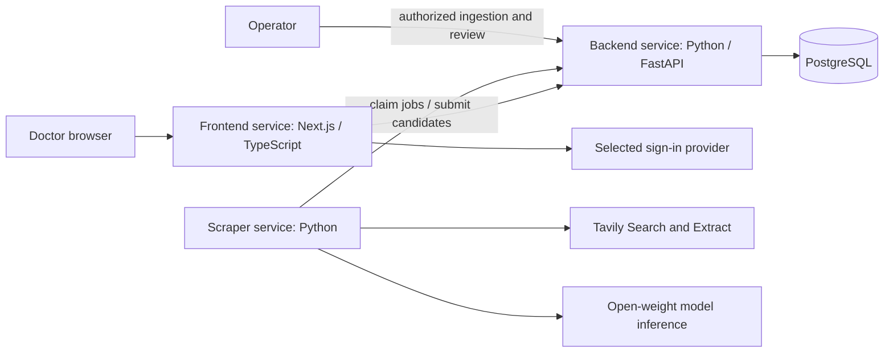

# CareCredits — spec-driven development specification

Version: 0.2 · 2026-09-15 · Status: implementation specification; most features remain planned.

This document expands the initial Tavily discovery specification using the owner's supplied meeting summary. It defines the full Malaysia MVP and the contracts needed to build it. It does not claim that the described application is already implemented.

## 1. Source of requirements and precedence

The meeting decisions are the product baseline. Earlier instructions additionally require actual Tavily API usage and mention a Nebius backend. The earlier design placed scraping inside FastAPI; **the meeting decision supersedes that target architecture: the scraper must become a separate Python service**. Existing adapter code should be reused during the move.

Spelling is normalized to **Tavily** from “Tavalli.” “DiveScript” is interpreted as JavaScript as stated in the summary. Retaining the existing TypeScript/Next.js frontend meets the JavaScript-based service decision; a rewrite to plain JavaScript is not required.

| ID | Confirmed owner/meeting requirement |
| --- | --- |
| DEC-01 | Three separately runnable application services: backend, frontend, scraper |
| DEC-02 | Python backend owns the primary PostgreSQL database |
| DEC-03 | Python scraper and JavaScript-based frontend |
| DEC-04 | Tavily API collects training data; real Search and Extract usage is required |
| DEC-05 | Initial geography is Malaysia; user-facing terminology is CPD |
| DEC-06 | Doctor sign-in, nearby discovery, sign-up tracking, attendance tracking and learning progress |
| DEC-07 | Show CPD points, prerequisites, beginner/intermediate/advanced difficulty, and fees |
| DEC-08 | Use open-weight models for application AI |

An implementation default below is a concrete proposal, not a recorded meeting decision. Defaults can be revised with a documented reason; they must not silently change confirmed requirements. Official hackathon rules, model eligibility, deadline and judging criteria are still unverified. Nebius remains an open dependency decision, not a cancelled requirement.

## 2. Product goal and success

Help doctors in Malaysia find relevant CPD training and maintain a personal record of activities they have signed up for and attended. The problem hypothesis is that opportunities and records are fragmented; user research has not yet established its frequency or cost.

The MVP succeeds when a doctor can sign in, choose a Malaysian location, find a real source-backed training, inspect its points and practical requirements, open the provider's registration page, record a sign-up, mark attendance, and see the personal dashboard update without duplicating the activity or its points.

The hackathon demonstration must additionally show a real Tavily Search → Extract run and a real open-weight model extraction run. Saved fixtures may support offline development but cannot substitute for those claims.

### MVP boundary

Include sign-in, profile/location, database-backed discovery and filters, training detail, personal sign-up and attendance records, CPD progress, operator ingestion/review, source evidence, and loading/empty/error states.

Implementation defaults:

- Sign-up means **recording that the doctor registered externally**. The app links to the provider; clicking the link alone does not register the doctor. Integrated booking/payment is outside MVP.
- Attendance is a reversible self-reported record. It is not independently verified completion or regulator-approved credit.
- Progress initially means signed-up count, attended count, and separately labelled recorded CPD totals. Optional personal notes support reflection; quizzes, competency scoring and an LMS are outside MVP.
- Online training is included only when a source establishes Malaysian relevance or participation eligibility. Global online training is not included merely because it is reachable from Malaysia.
- No automatic licence-renewal decision, universal annual target, accreditation guarantee, payment collection, certificate OCR, notifications or personalized AI recommendation engine in MVP.

## 3. Domain vocabulary

| Term | Definition |
| --- | --- |
| Training | A learning activity described by a provider |
| Session | One dated occurrence of a training; personal records attach to this occurrence |
| CPD points | User-facing label for advertised learning credits; it does not establish eligibility |
| Source credit label | Original provider wording, such as CPD, CME or CE, preserved alongside the UI label |
| Source | Original page URL and the retrieved evidence supporting an event field |
| Signed up | Doctor's record that external registration occurred |
| Attended | Doctor's self-reported participation in a session |
| Recorded points | Points the doctor explicitly records for attendance; distinct from advertised points |
| Verified | A specific claim reviewed against identified evidence, with reviewer and date |
| Unknown | Source does not establish a value; stored as null, never zero or a guessed value |

Calling credits CPDs in the UI does not imply that global schemes are equivalent or convertible. A source credit label that is not approved for aggregation remains visible but excluded from the CPD subtotal with an explanation.

## 4. Users and journeys

### Doctor

1. Sign in and create a profile; no claim of medical registration verification is made.
2. Select city/state or optionally consent to location access. Location denial does not block use.
3. Search upcoming trainings, filter by date, delivery mode, distance/location, cost, difficulty and advertised CPD points.
4. Open training details: provider, time, venue/online mode, prerequisites, difficulty, fees, advertised points, registration link and supporting sources. Unknowns are explicit.
5. Open the external registration link. Return and choose “Mark as signed up”; the portal records the user's assertion.
6. After the event, choose “Mark as attended,” optionally record points and notes, then inspect updated progress. Correcting attendance or points recomputes totals.

### Operator

1. Configure server secrets locally or in deployment secret settings.
2. Submit a bounded Malaysia-specific ingestion job and inspect its status.
3. Review extracted candidates, ambiguous dates, missing fields, conflicts, duplicates and Malaysia eligibility.
4. Publish a source-supported session or reject/hold it with a reason. Publication is not accreditation verification.
5. Refresh a source; review material changes before updating published records.

## 5. Target architecture

| Component | Owns | Must not own |
| --- | --- | --- |
| Frontend | Sign-in experience, discovery, details, personal portal, accessible UI | Tavily/model keys, operator token, direct database access |
| Backend | Authentication enforcement, authorization, catalogue, personal records, job state, validation, publication, persistence, progress | Direct Tavily/model calls in the target architecture |
| Scraper | Tavily adapter, extraction, open-weight model invocation, candidate construction, job execution | Doctor records, unrestricted database credentials, final publication decisions |
| PostgreSQL | Durable application and ingestion records | Public browser access |

PostgreSQL is infrastructure, not a fourth application service. External identity and inference providers are dependencies. Each application service needs its own entry point, container build and health check. Only the backend has PostgreSQL write credentials. The scraper exchanges jobs/results through authenticated internal backend endpoints.

**Default job design:** use PostgreSQL-backed jobs owned by the backend; the scraper polls a claim endpoint. This avoids a separate message-broker service for the hackathon. Claims are atomic, one worker owns a job lease, and completion is idempotent. A crashed worker cannot cause silent loss or double publication.

### Migration from the current branch

The existing `backend/discovery.py` implements synchronous operator discovery inside FastAPI. Move its Tavily adapter and tests into the scraper service without losing provenance, bounds or error behavior. Add job contracts and backend-owned candidate storage. The existing `/discovery/search` is transitional and must be removed or explicitly disabled in the public release after migration; do not silently change its synchronous response into a job response. Update the setup command and Compose secret routing when the service moves.

The existing backend user-list/create endpoints are unauthenticated, and `backend/auth.py` says authentication is disabled. Restrict or replace them as part of sign-in work before a doctor pilot. A discovery bearer token does not solve user authentication.

## 6. Tavily and open-weight model pipeline

1. Operator supplies a topic and Malaysia scope; validate the input and create an ingestion job.
2. Scraper claims the job and calls Tavily Search with bounded results.
3. Canonicalize URLs conservatively, remove fragments, reject invalid/non-web/local URLs, and deduplicate exact source URLs. Do not strip meaningful query parameters.
4. Call Tavily Extract for the selected pages. Preserve snippets when extraction fails, with explicit failure status; snippet-only candidates remain in review and are not auto-published.
5. Send successful page text to the configured **open-weight model** to extract schema-conforming candidate sessions. Extract multiple sessions separately when a page describes several events.
6. Validate dates, values, enum fields and source excerpts deterministically. Model confidence does not prove correctness. Unsupported or malformed fields become null/review findings; do not repair them by inventing facts.
7. Submit candidates, evidence, model metadata and outcomes to the backend using an idempotent job-completion request.
8. Backend persists candidates and flags duplicates/conflicts. An operator publishes reviewed, Malaysia-relevant sessions.
9. Doctor searches use PostgreSQL, not a paid Tavily request on every keystroke.

The scraper uses Tavily for search/extraction and the open-weight model for structured interpretation. Disable optional generated search answers in the application flow. Do not claim that Tavily's internal models are open-weight: its proprietary internals are outside the application's model choice and the hackathon rules must resolve whether that matters.

### Model selection contract

Before choosing a model, record its identifier/version, publisher, weights source, licence, hosting provider, structured-output support, context limit and evidence that the weights are available. Open-weight is not automatically the same as unrestricted open-source licensing.

The model must accept source text and return structured event candidates, handle relevant English/Malay text, preserve source-language evidence, and support the selected deployment budget. Run an evaluation against reviewed examples before adopting it. No closed-weight fallback is allowed silently. Model failure leaves evidence in review or marks the job partial/failed; a demo fixture must be labelled.

Earlier Nebius intent is preserved: confirm whether Nebius is required for inference, application hosting, or both before locking deployment. Keep `MODEL_BASE_URL`, `MODEL_ID`, and `MODEL_API_KEY` configurable as a proposed interface; these variables and a model adapter are not implemented yet.

## 7. Functional requirements

Statuses describe this branch: **existing** means implemented code, not live-provider verification; **planned** means required work.

| ID | Requirement | Acceptance criterion | Status |
| --- | --- | --- | --- |
| AUTH-01 | Doctor sign-in/out | Selected provider session is validated server-side; logout invalidates local session; unauthenticated personal requests return 401 | Planned |
| AUTH-02 | Ownership isolation | A doctor cannot read or change another doctor's profile, registrations, attendance, notes or totals by changing IDs | Planned |
| GEO-01 | Malaysia location | City/state entry works without GPS; exact coordinates are optional; non-Malaysian in-person events cannot publish | Planned |
| GEO-02 | Nearby search | Use distance only when user and venue coordinates exist; otherwise use city/state and show distance unavailable | Planned |
| DISC-01 | Real Tavily Search | Bounded request uses Search for Malaysian medical training sources | Existing in backend; migrate |
| DISC-02 | Real Tavily Extract | Extract at most five unique returned URLs; empty Search results skip Extract | Existing in backend; migrate |
| DISC-03 | Provenance | Preserve URL, retrieval time, source text and extraction outcome through candidate/publication flow | Existing raw response; storage planned |
| DISC-04 | Failure honesty | Partial extraction keeps evidence and warnings; provider failure is never fabricated success | Existing raw response; jobs planned |
| DISC-05 | Bounded work | Query 3–300 trimmed characters; 1–5 search results; 30 seconds per Tavily call; no automatic paid retries | Existing; retain |
| AI-01 | Open-weight extraction | Approved open-weight model produces validated candidates with field-level excerpts and model/version metadata | Planned |
| EVT-01 | Required training fields | Details show title, provider, session dates, delivery mode/location, CPD points, prerequisites, difficulty and fees; unknowns are explicit | Planned |
| EVT-02 | Event identity and updates | Same source/session does not duplicate; different sessions on one page remain distinct; ambiguous matches require review | Planned |
| EVT-03 | Claim verification | Advertised points, publication and accreditation verification remain separate; verified claims have evidence/reviewer/time | Planned |
| FIND-01 | Catalogue filters | Combine text, date, city/state or radius, mode, points, difficulty and fee filters with pagination; clearing filters resets results | Planned |
| REG-01 | Sign-up record | Explicit user action records external sign-up once per doctor/session; opening provider link does not create a record | Planned |
| ATT-01 | Attendance record | User can mark eligible past/started session attended and correct it; future sessions cannot be marked attended | Planned |
| PROG-01 | Personal progress | Selected-year counts and recorded points derive from attendance; corrections cannot double count; unknown/unapproved values are excluded and disclosed | Planned |
| UI-01 | Full portal | Sign-in, discovery, detail, signed-up/attended lists and progress have loading, empty, error and retry states | Planned |
| SEC-01 | Private secret setup | Hidden input saves ignored owner-readable `.env`; no key reaches frontend or logs | Existing Tavily setup; service split planned |
| SEC-02 | Operator/service access | Doctor cannot start jobs or publish; scraper token cannot access personal data; missing integration configuration fails explicitly | Existing operator token; role split planned |
| OPS-01 | Controlled ingestion | Durable leased jobs, bounded workers, pagination, usage metadata and an explicit run budget; doctor search never calls Tavily | Planned |
| DEMO-01 | Real demonstration | Show one live Search/Extract run, one eligible model run, published results and personal tracking flow; separate live from fixture evidence | Pending |

## 8. Behavioural rules and defaults

### Discovery and location

- Default geography: country `MY`. A Malaysian webpage address alone is not proof of event location.
- Default time filter: upcoming sessions, ordered by next session start then stable ID. Unknown dates appear only when the user includes “Date not confirmed.”
- Nearby default: 25 km, selectable 10/25/50/100 km. These are product defaults, not meeting decisions. Calculate straight-line distance in the backend and label it approximate, not travel time.
- Without coordinates, use city/state matching. Online sessions have no distance; show them only when online/hybrid inclusion is selected and Malaysian relevance is established.
- Store timestamps in UTC when timezone is known and display Malaysian sessions in `Asia/Kuala_Lumpur`. Preserve date-only values as dates; do not invent a midnight time. Source timezone ambiguity stays in review.
- Difficulty is `beginner`, `intermediate`, `advanced`, or null. Do not infer it from points or price. Model suggestions without explicit source support remain review suggestions.
- Fees use decimal amounts and a currency code. Free means explicitly zero; unknown is null. MYR fee filters exclude other currencies and unknown values unless requested; no implicit currency conversion.
- Prerequisites may be source-supported text, explicitly “none stated by provider,” or unknown. Absence of text is not proof of no prerequisites.

### Personal tracking

Use separate fields `signup_status` (`not_recorded`, `signed_up`, `cancelled`) and `attendance_status` (`not_recorded`, `attended`). Attendance may be recorded without a prior sign-up because the doctor may discover an event retrospectively. Cancelling a sign-up does not erase past attendance.

A doctor can mark attendance when the session start has passed; date-only sessions become eligible on that local date. Unknown dates require the user to provide a non-future `attended_on` date. Corrections must preserve a change history. Marking attendance alone does not silently turn advertised points into earned points.

`recorded_points` is optional, nonnegative decimal, with `points_origin` (`self_reported`) and a preserved credit label. The selected-year dashboard sums only attended records with explicit eligible-to-aggregate CPD labels and known recorded points. Show excluded unknown/unmapped records separately. Removing attendance excludes its points while preserving correction history. No preset legal annual target or automatic CE/CME conversion is allowed. Which labels can aggregate is an operator-reviewed configuration, initially CPD only.

## 9. Data model

Use migrations and stable IDs. Existing integer user IDs may remain during migration; external identity references must be unique. All user-owned foreign keys derive from the validated session, not caller-supplied owner IDs.

| Entity | Core fields and constraints |
| --- | --- |
| DoctorProfile | user_id; identity_issuer + identity_subject unique; display_name; city/state; optional coordinates; location_consent_at; created_at |
| Training | id; title; provider_name; description; prerequisites nullable; difficulty nullable; created_at/updated_at |
| Session | id; training_id; start/end timestamps or date-only fields; timezone; mode; country/city/state/venue; nullable coordinates; fee_amount/currency; advertised_points; original_credit_label; registration_url; publication_status; cancellation_status |
| SourceDocument | id; canonical_url; content_hash; retrieved_at; extraction_status; source excerpt/text; ingestion_job_id; unique URL+content hash |
| FieldEvidence | session/candidate reference; field_name; source_document_id; verbatim excerpt; reviewed_by/at nullable |
| Candidate | id; ingestion_job_id; source-local event key; structured payload; schema_version; model metadata; validation findings; review state/reason; resulting session_id nullable |
| DoctorSession | id; user_id+session_id unique; signup_status; attendance_status; signed_up_at; attended_on; nullable recorded_points; original_credit_label; points_origin; optional personal_notes; version |
| IngestionJob | id; request key; query; limits; status; attempt; lease token/expiry; timestamps; provider outcomes; measured usage if available; sanitized error |
| AuditEvent | actor; entity/action; timestamp; changed fields; no secrets; doctor history visible only to its owner/admin policy |

Database checks enforce nonnegative fees/points, valid enums, end not before start, exactly defined date precision, and duplicate personal-record prevention. Date-only and timestamp representations must not disagree.

Same URL can describe many sessions. Deduplicate source documents independently of event identity. Candidate matching considers provider, title, session date and location; uncertain matches are reviewed, not automatically merged. Refreshes create new evidence versions and do not overwrite a doctor's attendance/points. Published sessions are retained or cancelled rather than deleted out from under personal records.

## 10. Target API and service contracts

All routes in this section are **planned** except the transitional route in section 11. JSON uses snake_case. Doctor authentication follows the selected identity provider; operator and scraper permissions are distinct. Mutation requests use server-side authorization and validation, including CSRF protection if cookie sessions are used.

| Method and route | Caller | Contract |
| --- | --- | --- |
| GET/PATCH `/api/v1/me` | Doctor | Read/update own location/preferences; no caller-supplied owner ID |
| GET `/api/v1/trainings` | Doctor | Query/filter catalogue; `page` >=1, `page_size` 1–50 (default 20); return items, total, page and applied filters |
| GET `/api/v1/trainings/{session_id}` | Doctor | Session detail, source evidence, publication/review labels and registration URL |
| GET `/api/v1/me/trainings` | Doctor | Filter own signed-up/attended records, paginated |
| PUT `/api/v1/me/trainings/{session_id}` | Doctor | Upsert signup/attendance, points and notes; version check prevents lost edits |
| GET `/api/v1/me/progress?year=YYYY` | Doctor | Counts, recorded CPD subtotal, excluded-record count/reasons; no compliance verdict |
| POST `/api/v1/admin/ingestion-jobs` | Operator | `{query,max_results}`; require Idempotency-Key; return 202 + job_id/status |
| GET `/api/v1/admin/ingestion-jobs/{id}` | Operator | State, counts, warnings and usage; no credentials |
| GET `/api/v1/admin/candidates` | Operator | Paginated review queue |
| POST `/api/v1/admin/candidates/{id}/review` | Operator | publish/reject/hold, reason, version and evidence-backed corrections |
| POST `/internal/v1/jobs/claim` | Scraper | Atomically lease one queued job; 204 if none; return lease_token and bounded job payload |
| POST `/internal/v1/jobs/{id}/heartbeat` | Scraper | Matching lease token extends lease within job deadline |
| POST `/internal/v1/jobs/{id}/complete` | Scraper | Matching lease + candidate batch + outcomes; idempotent completion |
| GET `/health/live` and `/health/ready` | Infrastructure | Liveness independent of paid providers; readiness reports required local configuration/connectivity |

Catalogue query fields: `q`, `city`, `state`, `latitude`, `longitude`, `radius_km`, `date_from`, `date_to`, `mode`, `difficulty`, `min_points`, `max_fee_myr`, `include_unknown`, `page`, `page_size`. Coordinates must be supplied together; radius requires coordinates. Incompatible/invalid filters return 422. Filtering by points or fees excludes unknowns unless explicitly included.

Normal responses are 200/201; jobs use 202. Return 401 for missing authentication, 403 for wrong role, 404 for unavailable or other-user records, 409 for version/idempotency conflict, 422 for invalid values and 429 for application throttling. Use a stable `{error:{code,message,request_id}}` envelope for target endpoints; never leak provider bodies or internal stack traces.

DoctorSession PUT represents the desired full state and includes the last-read `version` (0 for creation). Repeating an already-applied identical request returns the current record; a stale request that would change current state returns 409. DB uniqueness protects concurrent first writes. Missing source points do not prevent recording attendance.

### Job durability and limits

States: `queued → running → succeeded | partial | failed`; expired leases become `interrupted`, requiring an explicit operator retry with a new attempt. Do not automatically repeat paid calls after an ambiguous crash. Reusing the same idempotency key and body returns the same job; a different body returns 409. Completion checks lease ownership and stores candidates and terminal status in one transaction.

Defaults: one active worker, five source pages per job, maximum ten manually started jobs per operator per hour, 120-second lease with heartbeat every 30 seconds, five-minute total deadline. Apply per-call timeouts within that deadline. Model input/output caps are set after model selection; missing caps block model job readiness. These bounds limit work, not a guaranteed monetary spend. Record reported usage when available; unknown usage is null. No automatic scheduled crawling in MVP.

## 11. Existing implementation and evidence

At this revision, the branch implements synchronous `POST /discovery/search` with `Authorization: Bearer <DISCOVERY_API_TOKEN>` and body `{"query":"cardiology Kuala Lumpur 2026","max_results":5}`.

It returns `provider`, `query`, UTC `retrieved_at`, `sources` and `warnings`. Source fields are `url`, `title`, `snippet`, nullable `raw_content`, `extraction_status` and `verification_status: "unverified"`. Search failure returns an error; extraction failure retains snippets with warnings. Current errors are 401/422/503/429/502/504 using FastAPI's existing error format, not the target error envelope.

Ten mocked adapter/setup tests and a local HTTP smoke check passed in the preceding implementation. The smoke check covered health/OpenAPI, authorization, validation and missing key. No live Tavily call, model call, three-service deployment, doctor sign-in, event persistence, nearby UI or tracking flow has been verified. The dashboard still uses hardcoded example data, including non-Malaysian events. Merely updating this document changes none of that implementation status.

## 12. Security, privacy and operational requirements

- Prefer the existing repository's intended third-party OAuth direction; select a provider before implementing sign-in. Validate token issuer/audience/session expiry. Never accept an arbitrary email or user ID as identity proof.
- Separate doctor, operator and scraper permissions. Scraper cannot read personal profiles, notes or attendance. Frontend cannot obtain service tokens.
- After the service split, give Tavily/model secrets only to scraper; give database credentials only to backend. Restrict browser origins and internal endpoints. Current broad CORS and unauthenticated user endpoints must be corrected before a pilot.
- Collect city/state by default; exact location is optional. Do not put precise location, user identity, notes or patient data into Tavily/model prompts. Training discovery needs public event information only.
- Render source text as escaped text/sanitized content. Model output cannot issue tool calls, change authorization or publish itself. Reject unsafe links on publication even if Tavily returned them.
- Retain retrieval metadata and evidence required to explain listings. Default raw-page retention is 30 days; retain reviewed field excerpts while the listing needs them, subject to source terms and a documented privacy/retention review before a pilot.
- Log request/job IDs, counts, sanitized failures, durations and reported usage. Do not log API keys, bearer tokens, personal notes or raw identity tokens.
- Backend readiness checks PostgreSQL; scraper readiness checks required configuration without making a paid call. Provider outage must not make stored catalogue browsing fail.
- Proposed performance target: catalogue reads under one second at p95 on a seeded 1,000-session dataset with 10 concurrent readers, excluding external sign-in. Measure and report hardware/environment; this is a target, not an observed result.

## 13. Verification plan and traceability

| Test ID | Requirement IDs | Scenario and pass condition |
| --- | --- | --- |
| T-01 | AUTH-01, AUTH-02, SEC-02 | Sign-in/out plus two-user isolation; changing record IDs never exposes another user's data; doctors cannot ingest or publish |
| T-02 | DISC-01, DISC-02, DISC-05 | Mock Search/Extract contract; deduplicate URLs; no Extract on empty Search; input/result/time bounds preserved after migration |
| T-03 | DISC-03, DISC-04, OPS-01 | Partial extraction, malformed payload, missing key, timeout, 401/429/credit limits, process crash; preserve evidence and accurate terminal state |
| T-04 | AI-01, EVT-01, EVT-03 | Reviewed 20-page fixture set including English/Malay, missing fees/points, several sessions, ambiguous dates and malicious instructions; all accepted outputs schema-valid, every published non-null factual field has supporting evidence, no unsupported points/fees published |
| T-05 | EVT-02, OPS-01 | Re-import same page, changed content, several sessions per page, expired lease, duplicate completion and concurrent workers; no double publication or silent merge |
| T-06 | GEO-01, GEO-02, FIND-01 | Malaysia/non-Malaysia, radius boundary, denied location, missing venue coordinates, online eligibility, unknown fees and pagination; results match defined filters |
| T-07 | REG-01, ATT-01, PROG-01 | Link click does not sign up; repeated save does not duplicate; future attendance rejected; corrections and year boundary recalculate once; unknown/unmapped credits excluded visibly |
| T-08 | UI-01 | Keyboard-accessible sign-in/search/detail/portal, readable mobile layout, loading/empty/error states and retry; no fake success toast |
| T-09 | SEC-01, SEC-02, OPS-01 | Check built client assets/logs for test secrets, internal route access, database ownership, origin policy and spending limits |
| T-10 | DEMO-01, AI-01 | Real Tavily and selected open-weight inference calls; preserve redacted request evidence and model identity; demonstrate publish/search/track flow |

T-04 reports field accuracy and rejection rate in addition to its publication gate; a review step must not conceal a nonfunctional extractor. Empty/rejected output for all pages does not pass. Require correct usable candidates from at least 8 of 10 clearly specified, in-scope event fixtures; include the other 10 as edge/negative cases.

Mock tests run without secrets. Live tests are separate, explicitly use configured keys and consume credits. Do not claim live success from passing mocks. End-to-end tests use an isolated test database and two doctor accounts. Test failure/error states as well as the happy path.

## 14. Build plan

| Task | Dependencies | Deliverable and definition of done |
| --- | --- | --- |
| BUILD-01 | None | Obtain official rules; resolve Nebius, identity provider and eligible open-weight model; document decisions without claiming unverified compliance |
| BUILD-02 | None | Split Python scraper from backend; add containers, narrow secrets, durable job schema/contracts; pass T-02/T-03/T-05 service tests |
| BUILD-03 | BUILD-01 identity choice | Sign-in and ownership enforcement; remove/restrict unauthenticated user endpoints; pass T-01 |
| BUILD-04 | BUILD-01 model choice, BUILD-02 | Implement extraction schema, model adapter, evidence, evaluation and candidate review; pass T-04 |
| BUILD-05 | BUILD-02, BUILD-04 | Persist/publish sessions, deduplicate and expose filtered catalogue; pass T-05/T-06 |
| BUILD-06 | BUILD-03, BUILD-05 | Implement personal records, state/version rules and progress; pass T-07 |
| BUILD-07 | BUILD-03, BUILD-05, BUILD-06 | Connect frontend journeys; remove or label prototype fixtures; pass T-08/T-09 |
| BUILD-08 | BUILD-01–07 | Run three-service deployment, live integration and complete demo; record T-10 evidence and known limitations |

Do not estimate a delivery date until team size and remaining hackathon time are known. If time is short, propose reducing optional polish or tracking detail; do not silently drop the three-service, Tavily, open-weight, Malaysia or personal-tracking decisions.

## 15. Demo script and completion gate

1. Show the three running application services and backend-owned database.
2. Show configured integration status without revealing secrets; identify the selected open-weight model and its weights/licence evidence.
3. Run a bounded real Malaysia training ingestion job; show Tavily source URLs and extraction outcome.
4. Inspect model-produced candidates and field evidence; review and publish one suitable session.
5. Sign in as a doctor, select a Malaysian location, filter and inspect the published training.
6. Open provider registration; explicitly record sign-up; demonstrate attendance on a past session and recorded-point correction.
7. Show updated personal progress and explain self-reported versus verified information.

Release gate: confirmed meeting requirements have working implementations and linked passing tests; official hackathon requirements are checked; secrets are absent from client/logs/repository; real API/model use is evidenced; placeholders are labelled or removed; failures do not fabricate success. Unfinished items remain explicitly listed.

## 16. Open decisions

| ID | Question | Working position / impact |
| --- | --- | --- |
| OPEN-01 | Which hackathon and exact rules? | Owner requirements guide work; official eligibility/submission requirements still need verification |
| OPEN-02 | Required Nebius role? | Earlier requirement preserved; resolve before final inference/deployment choice |
| OPEN-03 | Which open-weight model/host/licence? | Required before live AI integration; no closed-weight substitute |
| OPEN-04 | Identity provider? | Follow repository intent for third-party sign-in; provider selection unresolved |
| OPEN-05 | Which providers/accreditation sources? | Reviewed public sources initially; no automatic official eligibility claim |
| OPEN-06 | Does sign-up mean integrated registration? | Default is external registration plus personal record; integration would expand scope |
| OPEN-07 | What proves attendance and credits? | Self-report MVP; verification/certificate workflow is a later decision |
| OPEN-08 | Location/geocoding source and approved online scope? | Manual city/state works first; no geocoder vendor chosen |
| OPEN-09 | Team, deadline, credit budget and hosting? | Required to prioritize work and set deployment limits |

## 17. References and change log

- Product source: owner's meeting summary supplied in this task; DEC-01–08 preserve its decisions.
- [Tavily Search API](https://docs.tavily.com/documentation/api-reference/endpoint/search)
- [Tavily Extract API](https://docs.tavily.com/documentation/api-reference/endpoint/extract)
- Repository evidence: `backend/discovery.py`, `backend/main.py`, `backend/auth.py`, `backend/models.py`, `frontend/app/page.tsx`, `docker-compose.yml`.

v0.1 established Tavily discovery inside the backend. v0.2 supersedes that target with the confirmed three-service design, adds open-weight extraction, defines the complete doctor portal and tracking rules, and preserves the distinction between existing code and planned requirements. Tavily API contracts were checked during the preceding implementation; this revision does not independently verify hackathon rules or Malaysian regulatory requirements.
